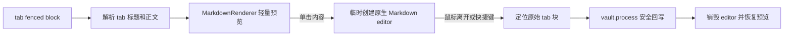

# Obsidian Code Tab（轻量预览与原生编辑版）

在 Obsidian 笔记中使用 Markdown 创建可切换的标签页，并直接在阅读界面里编辑标签内容。

本派生版本由 **volmodaoist** 开发和维护，基于 [lazyloong/obsidian-code-tab](https://github.com/lazyloong/obsidian-code-tab) 的 `2.0-alpha` 版本改造，重点解决两个体验问题：

- 浏览时不为每个标签常驻一个完整 Markdown 编辑器，减少多余留白和复杂控件。
- 编辑时按需使用 Obsidian 原生 Markdown 编辑器，代码正文与预览共用高亮规则。

## 功能特点

- 支持任意数量的标签。
- 标签栏末尾的 `+` 可直接新增并选中一个空代码标签。
- 双击标签标题可原地重命名，Enter 或失焦保存，Esc 取消。
- 右键标签选择“删除标签”，确认后删除该标签及内容。
- 每个标签内可以放普通 Markdown、表格、列表、代码块及图片、笔记、Excalidraw 嵌入。
- 单击内容区域即可原地编辑。
- 编辑时使用 Obsidian 原生输入、选区和撤销；单代码块的着色与预览保持一致。
- 点击编辑时保持卡片尺寸和正文位置；新增或删除行时，代码块随内容自然增高或收缩。
- 标签只含一个完整代码块时直接编辑代码正文，围栏和语言标记保留在源文件中。
- 编辑时右下角显示渲染类型输入框，支持 `markdown`、代码语言及已安装插件的处理器名称；退出编辑后隐藏。
- 鼠标移出内容区域后自动保存。
- `Ctrl/Cmd + Enter` 可以立即保存。
- `Esc` 可以放弃本次修改。
- 使用方向键、`Home` 和 `End` 切换获得焦点的标签。
- 标签过多时支持横向滚动，但不显示突兀的滚动条。
- 保存时保留源文件原有的 LF 或 CRLF 换行格式。
- 预览时兼容 `c++`、`c#` 等编辑器与高亮器命名不一致的语言标记。

## 安装

本仓库维护 TypeScript 源码。开发环境需要 Node.js 20 或更高版本；先在仓库根目录执行：

```bash
npm ci
npm run build
```

构建产物位于 `dist/`，安装这些产物时不需要 Node.js。

1. 在 Obsidian 仓库中创建目录：

   ```text
   <你的仓库>/.obsidian/plugins/obsidian-code-tab/
   ```

2. 将 `dist/` 中的以下文件复制到该目录：

   ```text
   main.js
   manifest.json
   styles.css
   ```

3. 打开 Obsidian 的“设置 → 第三方插件”。
4. 关闭并重新打开 Code Tab，或者重启 Obsidian。

如果 Obsidian 尚未识别插件，可以先执行“重新加载插件”，再确认目录名和 `manifest.json` 中的 `id` 都是 `obsidian-code-tab`。

## 快速开始

### 普通 Markdown 标签

在 Markdown 中创建一个 `tab` fenced code block，并用 `tab: 标题` 分隔内容：

`````markdown
```tab
tab: 简介
这里可以写普通 **Markdown**。

tab: 注意事项
- 第一项
- 第二项
```
`````

渲染后会出现“简介”和“注意事项”两个标签。

### 在标签中放代码块

内部代码块通常使用三个反引号，因此外层 `tab` 块需要使用四个反引号：

``````markdown
````tab
tab: Python
```python
def greet(name: str) -> str:
    return f"Hello, {name}!"
```

tab: JavaScript
```javascript
function greet(name) {
  return `Hello, ${name}!`;
}
```
````
``````

简单原则：外层 fence 必须比内部同类型 fence 更长。插件保存时也会自动检查这一点，必要时增加外层 fence 的长度。

代码语言可以按日常习惯写成 `c++`。浏览态会在内存中将它映射为 Prism 能识别的 `cpp`，但不会修改笔记源文件：

`````markdown
```c++
#include <stdio.h>

int main() {
    return 0;
}
```
`````

### 使用命令创建

打开命令面板，执行：

```text
Code Tab: 创建标签组件
```

插件会在光标处插入包含两个标签的模板。

## 编辑方式

1. 在阅读视图中选择需要修改的标签。
2. 单击标签内容区域，进入原生 Markdown 编辑状态。
3. 单代码块直接修改正文；Markdown 使用宿主实时预览，可直接修改表格单元格。右下角可选择渲染类型。
4. 将鼠标移出内容区域，插件会自动保存并恢复预览。

快捷操作：

| 操作 | 结果 |
| --- | --- |
| 单击内容区域 | 进入编辑 |
| 标签栏末尾的 `+` | 保存当前编辑，新增并选中一个空代码标签 |
| 双击标签标题 | 原地输入新名称；Enter / 失焦保存，Esc 取消 |
| 右键标签 → 删除标签 | 打开确认弹窗；确认后删除标签及正文 |
| 编辑态右下角类型框 | 输入代码语言、`markdown` 或插件处理器名称；普通 `Enter` 回到正文 |
| 鼠标移出内容区域 | 自动保存并返回预览 |
| `Ctrl/Cmd + Enter` | 立即保存并返回预览 |
| `Esc` | 放弃本次修改并返回预览 |
| `←` / `→` | 在标签标题获得焦点时切换标签 |
| `Home` / `End` | 跳到第一个或最后一个标签 |

编辑过程中暂时不能切换到另一个标签。这是为了防止切换动作与异步文件保存发生竞争，造成当前编辑内容丢失。先让鼠标离开内容区域完成保存，再切换标签即可。

重命名不接受空名称，标题始终按普通文本显示；保存失败会保留输入。右键删除默认聚焦“取消”，关闭弹窗或按 Esc 都不会删除。删除非活动标签时继续显示当前页，删除活动标签时选择相邻页；删除最后一页会移除整个标签块，确认弹窗会明确提示。

新增标签默认使用“标签3、标签4……”等未被占用的名称，内容是一个 `text` 空代码块。点击新代码块即可输入，无需修改笔记源码；若当前编辑保存失败，则停止新增并保留当前内容。

右下角输入框表示整个标签的**渲染类型**，不限定为编程语言：

| 类型 | 保存后的显示方式 |
| --- | --- |
| `markdown` / `md` | 按 Markdown 渲染表格、段落、代码块和嵌入 |
| `python`、`javascript`、`c++`、`c#` 等 | 按对应语言显示代码高亮 |
| `mermaid` 或已安装插件的处理器名 | 交给 Obsidian 注册的渲染器处理 |
| 留空 / `text` / 未注册的类型 | 显示纯文本代码块 |

类型名可自由输入，只排除会破坏围栏结构的空白、反引号和波浪号。代码语言输入后会更新编辑中的高亮；代码与 Markdown 的格式转换在保存时生效，保留正在使用的编辑器和撤销历史。`Esc` 同时放弃正文与类型修改。Markdown 标签切换为代码时，整个标签正文会被包入代码围栏。

标签正文可以直接写 Markdown 表格，也兼容外包一层 `md` / `markdown` 围栏的写法。画布沿用 Obsidian 嵌入语法：

`````markdown
````tab
tab: 表格
| 标识 | 说明 |
| --- | --- |
| intent_id | 一次调仓意图 |

tab: 画布
![[Drawing.excalidraw.md]]
````
`````

画布文件需存在于当前仓库，并启用 Excalidraw 插件。点击画布交给 Excalidraw 处理；点击面板周围的留白可以编辑嵌入链接。仅输入 `excalidraw` 不会自动创建画布或安装对应插件。

进入编辑时，插件保留预览态的字号、行高、内边距、背景和 `4px` 圆角，正文位置与卡片尺寸保持一致。回车、粘贴或删除内容时，代码块像原生代码块一样自然增高或收缩；内容超出窗口时由笔记页面滚动，编辑器不产生内部纵向滚动条。取消修改后，预览恢复原来的尺寸。

输入引起的高度变化或页面滚动不会触发自动保存；只有主动将鼠标移到内容区域外才会保存并退出编辑。预览与编辑器交接时会短暂保留面板高度，初始化完成后立即释放，避免清空 DOM 的中间状态使整页滚动位置被裁短。

单代码块编辑使用 CodeMirror 的替换装饰折叠围栏，文档本身保持完整，保存时保留语言与围栏。全选、跳到文首/文末和拖选都限制在可见正文内，边界退格或粘贴不会改写围栏；原生编辑器不可用时，降级输入框也保留相同的正文编辑方式。

代码正文的高亮共用 Obsidian 预览器已加载的 Prism 语法定义和主题样式，通过 CodeMirror 的 mark 装饰显示。这样不会因为两套分词器对 `print` 等符号的分类不同，导致点击前后颜色改变。输入、粘贴和撤销后会重新着色；单纯移动光标不会重新分词。

原生 embed 自带的空标题、属性区和整页留白会被移除。预览和编辑使用相同的字号、行高及代码换行规则，避免窄窗口中长代码换行时产生额外首行。围栏保持行内折叠，保留空正文和末尾回车后的输入位置。

## 工作原理



### 为什么浏览态不用原生编辑器

上游 `2.0-alpha` 会为每个标签创建一个完整的 Markdown embed。即使标签当前不可见，它的编辑器对象、DOM 和监听器仍然存在，而且 embed 自带整页布局、标题和控制按钮。标签较多时，这会让组件显得臃肿。

当前版本在浏览态只调用公开的 `MarkdownRenderer`。只有被点击的标签会创建一个编辑器，因此页面平时保持轻量。

### 为什么编辑态仍然使用原生编辑器

曾尝试过使用 `textarea` 加高亮镜像层模拟代码编辑：透明输入框负责输入，底层或上层代码节点负责颜色显示。这个方案很容易受到 Obsidian 主题、Electron/WebView 的层叠上下文和文本填充规则影响，实际出现过点击后内容完全不可见的问题。

因此当前版本在用户点击时调用 Obsidian 的 Markdown embed editor，光标、选区、撤销和输入法兼容由原生编辑器负责。单代码块通过原生编辑器的装饰 API 共用预览的 Prism 着色；混合 Markdown 内容继续使用宿主的 Markdown 编辑模式。

### 为什么使用私有 API

Obsidian 的公开 API 可以渲染 Markdown，但目前没有提供一个等价的、可嵌入任意容器的完整 Markdown 编辑器接口。因此编辑态使用了：

```javascript
app.embedRegistry.getEmbedCreator({ extension: "md" })
```

`embedRegistry` 是私有 API，未来 Obsidian 升级后可能发生变化。插件已经准备了普通 `textarea` 降级路径：即使原生编辑器创建失败，内容仍然可见、可编辑、可保存。

### 保存为什么要匹配旧内容

一个笔记里可以有多个 `tab` 块，而且编辑期间源文件可能被另一个窗格或同步工具修改。插件保存时不会仅凭旧行号强行覆盖，而是：

1. 在当前文件中查找内容与编辑前完全一致的 `tab` 块。
2. 如果有多个匹配项，选择距离原始行号最近的一个。
3. 如果一个都找不到，停止保存并提示刷新笔记。

这是一种乐观并发保护，目标是宁可提示冲突，也不覆盖用户在其他位置完成的新修改。

## 语法约束

- 标签声明必须单独占一行，格式为 `tab: 标题`。
- 标签声明前允许有空格。
- fenced code block 内部出现的 `tab:` 不会被误识别为新标签。
- `c++` 和 `c#` 在预览时分别映射为 `cpp` 和 `csharp`，源 Markdown 保持原样。
- 空标题会自动显示为“标签1”“标签2”等名称。
- 标签内容首尾的空行会被规整，正文内部空行保持不变。
- 使用 `+` 新增标签，双击标题重命名，右键确认删除；排序仍可在源 Markdown 中调整。

## 开发与文件结构

```text
obsidian-code-tab/
├── src/
│   ├── main.ts                    # 插件注册、命令和标签选中状态
│   ├── markdown.ts                # 标签解析、序列化和源文件回写
│   ├── components/
│   │   ├── MultiTab/             # 标签组件：标题、预览、Markdown 编辑和保存
│   │   │   ├── index.ts          # 对外入口
│   │   │   ├── tabGroup.ts       # 标签切换、新增及保存/取消协调
│   │   │   ├── tabActions.ts     # 标题输入、右键菜单和删除确认
│   │   │   ├── tabContent.ts     # 内容分类与 Markdown/代码格式转换
│   │   │   ├── tabPreview.ts     # 宿主预览与语法加载
│   │   │   ├── tabEditor.ts      # 临时 Markdown 编辑会话
│   │   │   ├── renderTypeInput.ts # 渲染类型输入
│   │   │   ├── types.ts          # 标签数据与原生 embed 类型
│   │   │   └── styles.css        # 标签、面板、Markdown 编辑器样式
│   │   └── CodeBlockEditor/      # 单代码块编辑能力
│   │       ├── index.ts          # 对外入口
│   │       ├── fences.ts         # 正文范围、围栏折叠与编辑边界
│   │       ├── highlighting.ts   # Prism 着色装饰
│   │       ├── language.ts       # 类型名校验与围栏语言替换
│   │       └── styles.css        # 代码预览和编辑的共享样式
│   └── styles.css               # 汇总组件 CSS，由 esbuild 打包
├── tests/
│   ├── markdown.test.mjs          # 解析和文件回写回归测试
│   ├── code-block-editor.test.mjs # 正文范围、围栏折叠和编辑边界回归测试
│   ├── code-highlighting.test.mjs # token 范围、嵌套语法和输入后的着色更新
│   ├── code-language.test.mjs     # 语言修改与围栏、正文保留
│   ├── tab-content.test.mjs       # Markdown、代码及自定义类型的格式转换
│   ├── fixtures/table.md          # 表格位移回归使用的中文样例
│   └── obsidian/                 # 真实宿主的临时仓库、布局和输入回归测试
├── esbuild.config.mjs             # 构建和监听模式
├── manifest.json                  # 插件元数据
├── package.json
├── package-lock.json
├── tsconfig.json
├── README.md
├── LICENSE                        # MIT License
└── dist/                          # 构建产物，不提交到 Git
    ├── main.js
    ├── manifest.json
    └── styles.css
```

### 组件边界

`MultiTab` 管标签栏、Markdown 预览、临时编辑会话和安全保存；`CodeBlockEditor` 管单代码块的围栏保护、Prism 着色和代码样式。表格与画布走 Markdown 能力，编辑会话留在 `MultiTab`，不会被混进纯代码组件。

这里按目录划分职责，不强制每个目录再包一层 class。`index.ts` 只导出实际使用的入口，内部函数直接互相调用；每个标签的 DOM、预览和监听器由一个 `TabView` 关联，删除时一起释放。组件 CSS 保留 `.code-tab` 前缀，通过根样式汇总，最终仍只产出一个 `dist/styles.css`。

### 常用开发命令

以下命令均在仓库根目录执行，需要 Node.js 20 或更高版本：

| 命令 | 用途 | 运行结果 |
| --- | --- | --- |
| `npm ci` | 首次开发或依赖锁文件更新后安装依赖 | 按 `package-lock.json` 安装到 `node_modules/` |
| `npm run dev` | 开发时持续监听源码、样式和清单变化 | 自动更新 `dist/`，按 `Ctrl + C` 停止 |
| `npm run typecheck` | 单独检查 TypeScript 类型 | 在终端报告类型错误，不生成产物 |
| `npm run lint` | 检查 TypeScript/JavaScript 规则与格式 | 禁止单行分支、压缩函数体和单行对象属性 |
| `npm run lint:fix` | 自动修复 lint 与格式问题 | 用 ESLint 和 Prettier 统一多行风格 |
| `npm test` | 运行解析和文件回写回归测试 | 在终端显示测试结果，不打开界面 |
| `npm run test:obsidian` | 在本机 Obsidian 中自动运行交互回归 | 启动独立临时仓库，检查布局、输入及文件回写，输出截图和报告目录 |
| `npm run build` | 检查类型并生成插件安装文件 | 生成 `dist/main.js`、`dist/manifest.json` 和 `dist/styles.css` |

首次开始开发：

```bash
npm ci
npm run dev
```

完成修改后，在另一个终端运行以下命令；也可以先停止监听再执行：

```bash
npm run lint && npm test && npm run build
```

`npm ci` 会安装本地 pre-commit hook，每次 `git commit` 自动运行 `npm run lint`。不覆盖 Trae 的托管 hook；它会继续调用本仓库的检查。新增组件时把样式放在组件目录，并由根 `src/styles.css` 导入，监听模式会自动追踪这些导入。

`npm run build` 已包含 TypeScript 类型检查，`npm run dev` 不做类型检查。构建与监听都只更新本仓库的 `dist/`，不会自动复制到 Obsidian 插件目录，也不会自动重新加载插件。

本仓库从已在插件目录运行的本地 `2.2.1` 版本迁入，保留既有功能与样式，并恢复了 TypeScript 源码、构建脚本和回归测试。后续改动以 `src/` 为准，不直接编辑 `dist/main.js`。旧版新增、删除、重命名和拖拽组件已由当前实现替换；历史代码可通过 Git 查看。

### 没有 Obsidian 时如何验证

当前仓库没有独立的浏览器预览页面。`npm run dev` 只启动构建监听，不会启动 HTTP 服务、输出 `localhost` 预览地址或打开前端页面。`dist/main.js` 是由 Obsidian 加载的插件入口，运行时依赖 Obsidian 提供的 API，不能通过直接打开文件或执行 `node dist/main.js` 来预览。

只安装 Node.js 时，可以运行 `npm run lint && npm test && npm run build`，验证以下内容：

- TypeScript 类型正确，源码可以打包生成插件产物。
- 标签解析、嵌套代码块、空标题和预览语言别名符合预期。
- 在模拟的 Vault 文件接口中，保存能正确定位目标标签块、保留 LF/CRLF 换行，并在原内容已改变时拒绝覆盖。

这些检查通过说明构建和已覆盖的逻辑符合预期。当前 `npm test` 不会启动真实 Obsidian、渲染界面或创建原生编辑器，因此不能据此确认主题外观、编辑器高亮、鼠标键盘交互和真实文件保存全部可用。

如果需要在浏览器里预览样式和基础交互，需要另外开发预览页面，并模拟 Markdown 渲染、文件读写等 Obsidian 接口。浏览器预览也无法完整验证 Obsidian 私有的原生编辑器 API；本仓库目前尚未提供这种预览入口。

### 在 Obsidian 中验证完整效果

1. 在 Obsidian 中创建并打开一个专门用于开发测试的笔记仓库（Vault）。
2. 执行 `npm run build`，将 `dist/` 中的三个文件复制到测试仓库的 `.obsidian/plugins/obsidian-code-tab/`。
3. 在“设置 → 第三方插件”中启用 Code Tab。
4. 新建笔记，粘贴本文“快速开始”中的示例，在阅读视图中检查标签和编辑效果。
5. 每次修改后，等待 `npm run dev` 完成构建，或重新执行 `npm run build`；再次复制产物，并关闭再启用插件，或重启 Obsidian。

完整回归时按下方清单检查，并确认编辑后的内容已写入笔记源 Markdown。

### 自动运行真实 Obsidian 回归

脚本都保存在本项目的 `tests/` 中，运行方式、脚本分工和组件定位标识见 [测试说明](tests/README.md)。

本机已安装 Obsidian 时可以执行：

```bash
npm ci
npm run test:obsidian
```

命令先构建插件，再启动独立的 Obsidian 窗口。测试使用新建的临时配置、插件目录和 `Test.md`，结束后关闭该测试进程；日志、截图、测试笔记和 `report.json` 保留在终端打印的 `Artifacts` 目录中。测试不会使用日常仓库，也不需要开启 Obsidian CLI。

默认路径适用于 macOS 的 `/Applications/Obsidian.app`。如果安装位置不同，可通过 `CODE_TAB_OBSIDIAN_BIN` 指定可执行文件，通过 `CODE_TAB_OBSIDIAN_DATA` 指定包含 `obsidian-版本.asar` 更新包的应用数据目录。脚本只复制更新包，以便使用与本机一致的应用版本。当前键盘回归按 macOS 的 Cmd 快捷键编写。

测试窗口默认隐藏，关闭后台节流后继续执行真实布局、输入和截图，避免桌面鼠标操作干扰测试。需要观察运行过程时，使用 `CODE_TAB_SHOW_TEST_WINDOW=1 npm run test:obsidian`。五组测试分别输出各自的截图和报告目录，其中表格切换测试会逐帧检查尺寸，避免只比较稳定后的布局而漏掉瞬间抖动。

覆盖阅读视图和实时预览、亮暗主题、宽窄窗口下的以下流程：

- 点击前后比较卡片、代码框、首字坐标、字号、行高和逐字符颜色/字重/字体样式。
- 覆盖 Python、JavaScript、C++、HTML、CSS、SQL、JSON 及未知语言的着色一致性。
- 跳到文末、回车、触发原生粘贴事件、撤销重做、快捷键保存，并检查实际 Markdown 文件。
- 文首退格、全选删除后重新输入、取消编辑，以及主动移出鼠标后的自动保存。
- 回车和粘贴后自然增高、删除后收缩、撤销后恢复高度；30 行正文完整撑开代码框且没有内部纵向滚动。
- 混合 Markdown 的完整编辑，以及私有 API 不可用时 textarea 的高度自适应和降级保存。
- 新增标签、标题避重、保存后新增、快速重复点击和回写失败保护。
- 双击改名、失焦提交、空名称和取消；删除确认、取消、最后一页及删除后的索引和选中状态。
- 加号图标与中英文标签文字在同一水平线上，覆盖宽窄窗口和新增标签后的布局。
- 编辑态类型框、即时高亮、语言别名、取消修改、未知类型及降级编辑器中的类型保存。
- 表格进入编辑前后的面板、表格和每个单元格尺寸；单元格保存与取消、添加行后自然增高、周围段落保留。
- `md` 围栏渲染、代码与 Markdown 相互转换、自定义处理器及嵌入点击。

可通过 `CODE_TAB_EXCALIDRAW_PLUGIN` 指向本机 Excalidraw 插件目录，额外验证真实画布嵌入，具体命令见 [测试说明](tests/README.md)。

这套测试使用真实的 Obsidian 渲染器、CodeMirror 和文件回写。第三方主题或其他插件可能影响宿主行为，修改相关设置后仍应在自己的仓库中复测。

## 手工测试清单

修改插件后，建议至少检查：

- 普通 Markdown 标签可以正常渲染和切换。
- 标签内的三反引号代码块不会截断外层四反引号 `tab` 块。
- 单击内容后出现原生编辑器，内容不为空。
- 单代码块点击前后语法颜色一致，修改内容后高亮跟随更新。
- 单代码块点击编辑时围栏隐藏，卡片、代码框和正文位置保持稳定。
- 回车或粘贴多行后代码块自然增高，删除内容后收缩，撤销恢复高度；内容超出窗口时由整页滚动。
- 输入时的布局变化和页面滚动不会打断编辑，取消修改后恢复原来的预览尺寸。
- 全选替换和边界退格不会删除源文件中的代码围栏或语言名。
- 跳到文末后回车、粘贴，新代码仍位于结束围栏之前；全选删除后重新输入不多出空行。
- 鼠标离开后内容写回当前标签，而不是其他同名标签。
- `Esc` 不写文件，`Ctrl/Cmd + Enter` 能立即保存。
- 同一篇笔记有多个 `tab` 块时均能正确保存。
- 亮色和暗色主题下 Tab 没有按钮阴影或可见滚动条。
- 原始文件使用 CRLF 时，保存不会把整段换成 LF。

## 已知限制

- 原生嵌入编辑器依赖 Obsidian 私有 API，Obsidian 大版本升级后需要回归测试。
- 移动设备没有稳定的鼠标离开事件，建议使用 `Ctrl/Cmd + Enter`，或切换到源码模式编辑。
- 当前编辑会话未结束时不会切换标签，以免丢失尚未保存的内容。

## 演进记录

### 上游 2.0-alpha

- 每个标签常驻一个原生 Markdown embed。
- 支持新增、删除、重命名、拖拽和内容编辑。
- 缺点是布局偏重，容易出现整页 padding 和多余 embed 控件。

### 本地重写 2.0.1

- 浏览态改用公开的 `MarkdownRenderer`。
- 页面更紧凑，但暂时移除了阅读视图中的直接编辑。

### 2.1.x 探索

- 尝试以轻量 `textarea` 实现点击编辑和自动保存。
- 又尝试叠加高亮镜像层模拟实时语法颜色。
- 该方案在部分主题和 WebView 中会出现透明文字与高亮层都不可见的问题，因此最终废弃。

### 2.2.0

- 浏览态继续保留轻量渲染。
- 编辑态改为按需创建 Obsidian 原生 Markdown embed editor。
- 保存后立即卸载编辑器，并保留可见 textarea 降级路径。
- 保留无阴影标签样式、隐藏滚动条和自动保存体验。

### 2.2.1

- 修复 `c++`、`c#` 在编辑态能够识别，但浏览态缺少语法高亮的问题。
- 语言别名只在传给 MarkdownRenderer 的副本中转换，不改写用户源文件。

## 分享与致谢

本版本基于以下项目改造：

- 上游仓库：[lazyloong/obsidian-code-tab](https://github.com/lazyloong/obsidian-code-tab)
- 上游版本：`2.0-alpha`
- 上游作者：lazyloong
- 许可证：MIT

如果要公开发布修改版，建议在仓库说明和 Release 中保留上述来源，并明确标注这是派生版本。
