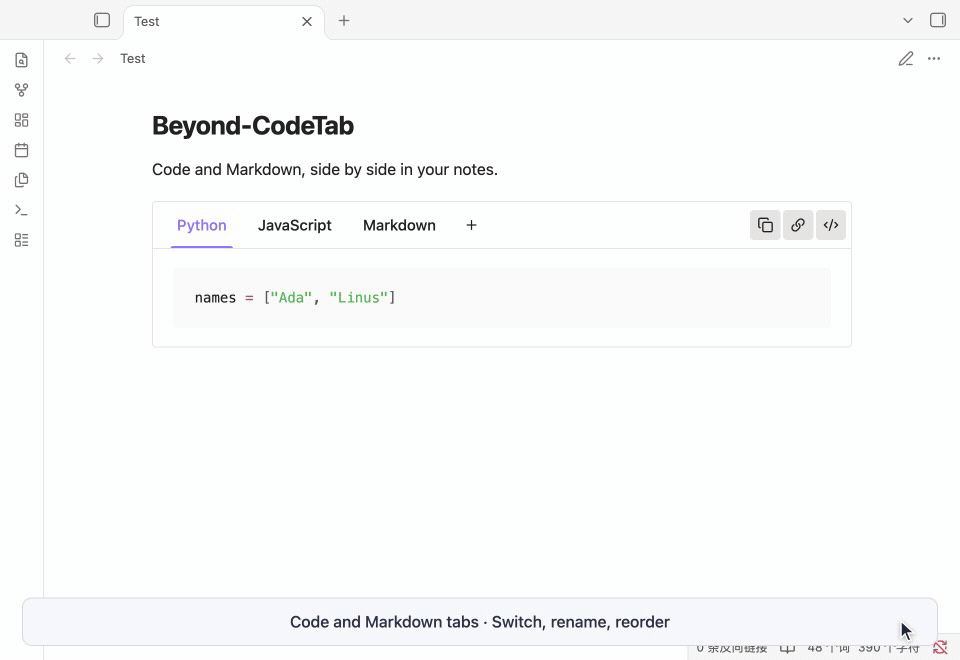
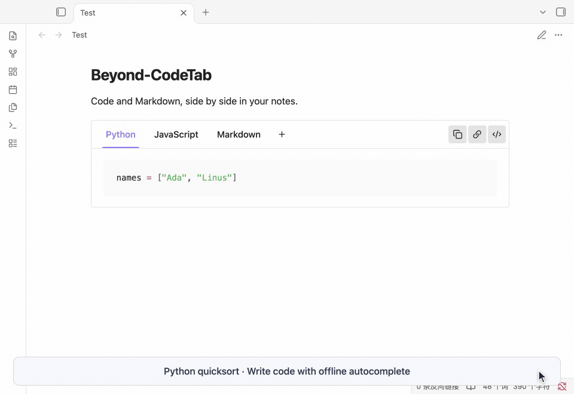
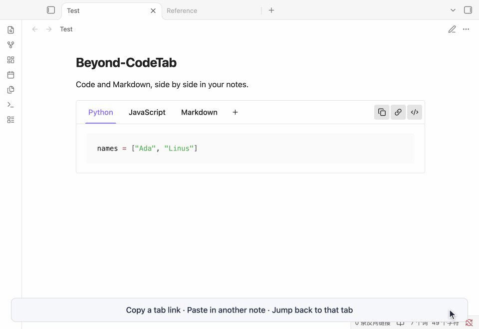
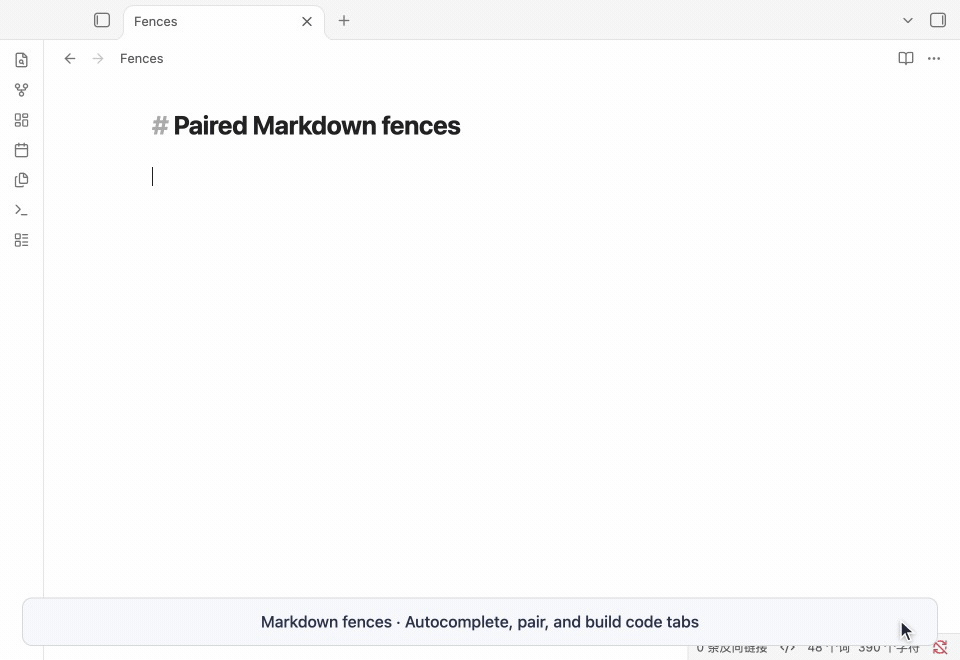

# Beyond-CodeTab: 增强 Obsidian 原生的 Code Block

本项目是一个 Obsidian 插件，能够增强原生的 code block，把它变成了 code tabs！

你可以通过 tabs 管理组织 Markdown、代码、表格，把笔记组织变成可切换的标签页，通过这种方式来把逻辑关联的部分内聚在一个版面之内，

使用场景：

- 组织数学定理
- 多个Excalidraw 示意图等等
- LeetCode 算法题解，一道题的多种解法，或者同一个逻辑的多种编程语言示意


<p align="center">
  <a href="README.md">中文</a> ·
  <a href="READMEs/README.en.md">English</a> ·
  <a href="READMEs/README.ja.md">日本語</a> ·
  <a href="READMEs/README.ko.md">한국어</a>
</p>

<p align="center">
  <a href="#gif-demos">GIF 演示</a> ·
  <a href="docs/community.md">社区与检索</a> ·
  <a href="https://github.com/volmodaoist/Beyond-CodeTab/issues/new/choose">反馈问题</a>
</p>

项目：[volmodaoist/Beyond-CodeTab](https://github.com/volmodaoist/Beyond-CodeTab) · 作者：[volmodaoist](https://github.com/volmodaoist) · 许可证：[MIT](LICENSE)

## 🎉 功能特点

每个 tab 支持以下功能：

- 👀 **所见即所得的管理方式**：

  - 双击改名或右键点击删除
  - 标签新增、切换、拖动排序，结果自动回写 Markdown
  - 点击内容即可原地编辑，编辑区域随正文增高和收缩
- 🧩 **支持多种 tab 内容，而不仅仅是代码块**

  - ⌨️ 支持普通 Markdown、表格、图片、笔记，以及第三方插件嵌入，比如 Excalidraw 绘图
  - 📽 支持 Excalidraw Frame Deck，单独嵌入的画布包含多个 Frame 时可逐页浏览，效果类似 PPT 翻页，详见[说明](docs/feat/excalidraw-frame-deck.md)。
  - 🧑‍💻 支持代码块，相较于原生的代码块，另外提供了可配置的代码补全，
    - 目前内置 Java、C、C++、Python、JavaScript、TypeScript、Go、Shell 词表补全，
    - 如果没有你常使用的编程语言，也可以自定义词表和规则，顺带一提，代码补全相关的插件放在 Core 模块，可独立复制使用，你可以整个剪切带走放进你项目里面，只要声明原作者的贡献~
- ⚡️标签栏右侧提供了三个便捷的按钮，包括：

  - 复制当前页完整内容
  - 生成指定标签的跳转引用 (一键复制可定位到具体 tab 页面的引用)
  - 打开整个标签组的源码
- 🤖 提供 [OpenAPI](src/openapi/api-doc.md)，其他插件可嵌入标签组、同步内容并接管保存；

## 🎯 安装与更新

构建需要 Node.js 20 或更高版本，请在 repo 根目录执行：

```bash
npm ci
npm run build
```

以上命令只生成本仓库的 `dist/` 构建产物。手动安装时：

1. 在目标 Vault 中创建 `.obsidian/plugins/obsidian-code-tab/`。
2. 将 `dist/main.js`、`dist/manifest.json`、`dist/styles.css` 复制进去。
3. 在 Obsidian “设置 → 第三方插件” 中启用 **Beyond-CodeTab**。更新已启用的插件后，关闭再启用，或重启 Obsidian。

本项目支持使用 Make 快捷命令进行安装，在仓库根目录运行 `make` 查看帮助。常用入口：

```bash
make build                   # 类型检查并构建
make check                   # 核心测试、构建、lint 和文档检查
make lint-fix                # 自动修复代码风格
make test-obsidian           # 真实 Obsidian 回归
make demos                   # 录制下面的 GIF（需要 FFmpeg）
make docs-check              # 检查文档链接、目录锚点和 GIF
make install vault="/Your/Vault 路径"
```

安装命令通过 `vault="..."` 指定目标 Vault，会在缺少构建依赖时自动运行 `npm ci`，并构建当前源码，只替换三个运行文件并且默认保留插件配置。

<a id="gif-demos"></a>

## 👀 GIF 演示

### 通过标签组织内容



### 可配置的代码补全



### 可快捷引用



### 自动配对与补全



录制命令、素材来源和重新生成方式见[演示说明](docs/assets/demos/README.md)。

## 🚀 快速开始

### 创建普通 Markdown Tabs

可在 Markdown 之中创建一个 `tab` fenced code block，并用 `tab: 标题` 分隔每个标签页面内容，渲染之后，会出现“简介”和“注意事项”两个标签。

````markdown
```tab
tab: 简介
这里可以写普通 **Markdown**。

tab: 注意事项
- 第一项
- 第二项
```
````

### 使用多个 Tabs 管理代码块

内部代码块通常使用三个反引号，因此外层 `tab` 块需要使用四个反引号：

`````markdown
````tab
tab: Python
```python
def greet(name: str) -> str:
    return f"Hello, {name}!"
```

tab: JavaScript
```javascript
function greet(name) {
  return `Hello, ${name}!`;
}
```
````
`````

三反引号或四反引号都有自动配对与补全，新输入或粘贴四反引号后回车，也能生成对应结束围栏。两端修改作为一次可撤销操作。含有内层三个反引号代码块的 tab 组仍应使用四个或更多反引号；自动配对不改变 Markdown 嵌套规则。保存时也会按内层围栏长度保护外层结构。

代码语言可以按日常习惯写成 `c++`。浏览态会在内存中将它映射为 Prism 能识别的 `cpp`：

````markdown
```c++
#include <stdio.h>

int main() {
    return 0;
}
```
````

### 使用命令创建

打开命令面板，执行：

```text
Beyond-CodeTab: 创建标签组件
```

插件会在光标处插入包含两个标签的模板。新增标签默认使用 “标签3、标签4……” 等未被占用的名称，内容是一个 `text` 类型的空代码块，点击新代码块即可输入，无需修改笔记源码

### 编辑方式

1. 在阅读视图中选择需要修改的标签。
2. 单击标签内容区域，进入原生 Markdown 编辑状态。
3. 右上角 `</>` 用于打开整个标签组的原生源码编辑，包括外层围栏和所有 `tab:` 声明。
4. 鼠标移出内容区域，插件会自动保存并恢复预览。

### 复制与标签引用

引用按钮生成并复制一个 Markdown 链接，粘贴到其他笔记后可定位到这个 tab 组并选中对应标签。首次生成时，会在原文件中保存两个标识：

- 标签组原生块 ID：使用六位 ID，放在外层结束围栏之后，e.g. `^a1b2c3`。
- 标签的稳定 ID：标签组六位 ID + 标签六位 ID，直接写在标题行末尾，e.g. `tab: Python ^a1b2c3-d4e5f6`，界面只显示标题，不渲染引用编号。改名、修改正文和排序都会保留标签 ID。复制正文的时候不包含这些 ID 标识；
- 删除标签后，旧引用会提示目标不存在

完整结构如下；外层组 ID 是原生块标识，内部标签 ID 由 Beyond-CodeTab 解析：

`````markdown
````tab
tab: Python ^a1b2c3-d4e5f6
假装这里有一段 Python 标签正文

tab: Shell ^a1b2c3-112233
假装这里有一段 Shell 标签正文
````
^a1b2c3
`````

例如，专用跳转链接的形式如下所示，其包含标签组 ID、标签 ID，

```markdown
[Python](obsidian://beyond-code-tab?block=a1b2c3&tab=d4e5f6)
```

标签组 ID 同时能用于原生 `[[Example#^a1b2c3]]` 和 `![[Example#^a1b2c3]]` 原生链接定位或嵌入整个组，专用链接再选择具体标签，原生块 ID 只能使用英文字母、数字和连字符；代码块 ID 必须写在结束围栏外的独立一行。

- 这是跳转链接，而非原生嵌入，笔记移动、改名或 Vault 改名之后无需重建链接；
- 复制到另一个 Vault 之后，只要 Vault 安装了当前的插件，并且存在相应标签组，即可跳转。


### 代码补全

进入标签编辑后，输入关键词前缀自动显示候选；`Ctrl + Space` 可主动触发。代码补全只作用于代码块正文。单代码块使用右下角类型框指定语言，混合 Markdown 之中，每个代码块使用自己的围栏语言。

| 语言       | 常见别名                             | 示例                     |
| ---------- | ------------------------------------ | ------------------------ |
| Java       | `java`                             | `pub` → `public`    |
| C          | `c`                                | `pri` → `printf`    |
| C++        | `cpp`、`c++`、`cc`、`cxx`    | `vec` → `vector`    |
| Python     | `python`、`python3`、`py`      | `enu` → `enumerate` |
| JavaScript | `javascript`、`js`、`jsx`      | `con` → `const`     |
| TypeScript | `typescript`、`ts`、`tsx`      | `key` → `keyof`     |
| Go         | `go`、`golang`                   | `def` → `defer`     |
| Shell      | `shell`、`sh`、`bash`、`zsh` | `ech` → `echo`      |

如果你想添加自己的词表与规则，可以打开“设置 → Beyond-CodeTab”，把以下 JSON 填入“自定义代码补全”，点击“应用补全配置”

```json
{
  "wordLists": [
    {
      "id": "my-commands",
      "languages": ["shell"],
      "words": [
        "deployLocal",
        { "label": "greet", "insertText": "echo hello", "detail": "打印问候" }
      ]
    }
  ],
  "rules": [
    {
      "id": "docker-commands",
      "languages": ["shell"],
      "match": "docker\\s+\\w*$",
      "words": ["composeLocal"]
    }
  ]
}
```

词表提供了三种代码补全形式，以上述代码片段为例：

- **单词补全**： Shell 代码之中输入 `depl` 可以选择 `deployLocal`；
- **缩写补全**：输入 `gre` 之后选择 `greet`，会实际插入 `echo hello`；`label` 用于显示与前缀匹配，`insertText` 可指定实际插入内容。
- **规则补全**：输入 `docker co` 可以选择规则词条，得到 `docker composeLocal`，规则的 `match` 匹配光标前的当前行，默认只替换正在输入的词。JSON 中的正则反斜杠需要写为 `\\`。

配置中的每项需要唯一 `id`、适用 `languages` 和 `words`，如果不知道如何配置也没有关系，把这个文档丢给 Agent，让它帮你解决。配置校验通过才可保存并生效。无效配置保留原设置。

补全是离线词表与规则，不做类型推断、自动导入或 LSP 查询

清空自定义补全可应用 `{"wordLists": [], "rules": []}`，内置词表仍然可用。配置格式和函数规则见[补全 Core 文档](docs/feat/code-completion-core.md)。


## ⌨️ 快捷操作

| 操作                | 结果                                                         |
| ------------------- | ------------------------------------------------------------ |
| 单击内容区域        | 进入编辑                                                     |
| 标签栏末尾的 `+`    | 保存当前编辑，新增并选中一个空代码标签                       |
| 拖动标签标题        | 调整标签相对位置，并同步写回 Markdown                        |
| 双击标签标题        | 原地输入新名称；Enter / 失焦保存，Esc 取消                   |
| 右键标签 → 删除标签 | 打开确认弹窗；确认后删除标签及正文                           |
| 编辑态右下角类型框  | 输入代码语言、`markdown` 或插件处理器名称；普通 `Enter` 回到正文 |
| 鼠标移出内容区域    | 自动保存并返回预览                                           |
| `Ctrl/Cmd + Enter`  | 立即保存并返回预览                                           |
| `Esc`               | 有候选窗口时先关闭候选；再次按下取消修改并返回预览           |
| `←` / `→`           | 在标签标题获得焦点时切换标签                                 |
| `Home` / `End`      | 跳到第一个或最后一个标签                                     |

右下角输入框表示整个标签的**渲染类型**，不限定为编程语言：

| 类型                                   | 保存后的显示方式                           |
| -------------------------------------- | ------------------------------------------ |
| `markdown` / `md`                      | 按照 Markdown 渲染表格、段落、代码块和嵌入 |
| `python`、`javascript`、`c++`、`c#` 等 | 按对应语言显示代码高亮                     |
| `mermaid` 或者已安装插件的处理器名     | 交给 Obsidian 注册的渲染器处理             |
| 留空 /`text` / 未注册的类型            | 显示纯文本代码块                           |

举个例子，标签正文可以直接写 Markdown 表格，也兼容外包一层 `md` / `markdown` 围栏的写法。画布沿用 Obsidian 嵌入语法：

`````markdown
```tab
tab: 表格
| 标识 | 说明 |
| --- | --- |
| intent_id | 一次调仓意图 |

tab: 画布
![[Drawing.excalidraw.md]]
```
`````

画布文件需存在于当前仓库，并且启用 Excalidraw 插件。点击画布交给 Excalidraw 处理

点击面板周围的留白可以编辑嵌入链接，若仅输入 `excalidraw` 不会自动创建画布或安装对应插件。

编辑区随内容自然增高和收缩，长内容由整页滚动。输入或页面滚动不会触发自动保存；主动移出内容区域、显式保存快捷键才会提交。鼠标移向补全候选窗口时仍保留当前编辑会话。


<a id="faq"></a>

## ⁉️ 常见问题

**看不到标签页**：确认笔记使用 `tab` 围栏，标签声明单独占一行。标签内有三个反引号代码块时，外层使用四个反引号；阅读视图或实时预览才会显示组件，源码模式显示原始 Markdown。

**更新后仍是旧名称或旧行为**：确认替换的是当前 Vault 的插件目录，然后关闭再启用插件。`npm run build` 和 `npm run dev` 只更新本仓库的 `dist/`，不会自动安装到 Vault。

**补全没有出现**：先点击进入代码编辑，核对语言标记，再尝试 `Ctrl + Space`。`Esc` 在候选窗口打开时先关闭候选，下一次才取消编辑。

**保存提示内容冲突**：编辑期间源文件可能被其他窗格或同步工具改动。插件拒绝覆盖找不到原内容的块，保留草稿；先复制需要保留的内容，再取消并重新打开最新笔记进行编辑。

注意事项 📢

- 重命名不接受空名称，标题始终按普通文本显示
- 代码语言输入后会更新编辑中的高亮，右下角的语言类型请勿填写会破坏围栏结构的空白、反引号和波浪号。
- 按下 `Esc` 同时放弃正文与类型修改。Markdown 标签切换为代码时，整个标签正文会被包入代码围栏。
- 编辑过程中暂时不能切换到另一个标签。这是为了防止切换动作与异步文件保存发生竞争，造成当前编辑内容丢失，注意先让鼠标离开内容区域完成保存，再切换标签即可。不过，即便保存失败，也会保留输入。
- 右键删除默认聚焦“取消”，关闭弹窗或按 Esc 都不会删除。删除非活动标签时继续显示当前页，删除活动标签时选择相邻页；删除最后一页会移除整个标签块，确认弹窗会明确提示。


## 🧑‍💻 开发与插件接入

| 需求                                         | 文档                                                        |
| -------------------------------------------- | ----------------------------------------------------------- |
| 嵌入标签组、获取类型提示、操作数据与保存回调 | [简洁 API 文档](src/openapi/api-doc.md)                        |
| 同步、冲突、只读与实例生命周期               | [宿主渲染契约](docs/host-rendering.md)                         |
| 在其他编辑器使用补全                         | [可复制模块 README](src/core/completion/README.md)             |
| 读源码、修改与本地调试                       | [插件开发入门](docs/tech/obsidian-plugin-development-guide.md) |
| 查看完整文档与专题                           | [文档导航](docs/README.md)                                     |

常用验证命令：

```bash
npm run lint
npm test
npm run build
npm run test:obsidian
```

前三项可在没有 Obsidian 的机器上运行。最后一项需要本机安装 Obsidian，使用独立临时 Vault 验证真实编辑、布局和回写，详见[测试说明](tests/test-guide.md)。开发约定见 [AGENTS.md](AGENTS.md)。


<a id="credits"></a>

## 🎨 分享与致谢

本项目维护者：[volmodaoist](https://github.com/volmodaoist)。当前仓库：[Beyond-CodeTab](https://github.com/volmodaoist/Beyond-CodeTab)。

本项目fork上游代码之后经过了几轮改造得到，在此致谢原项目作者：

- 上游仓库：[lazyloong/obsidian-code-tab](https://github.com/lazyloong/obsidian-code-tab)
- 上游版本：`2.0-alpha`
- 上游作者：lazyloong
- 许可证：MIT
