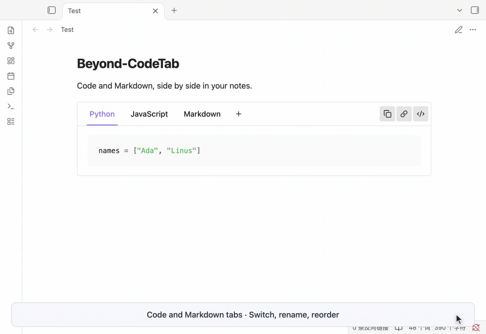
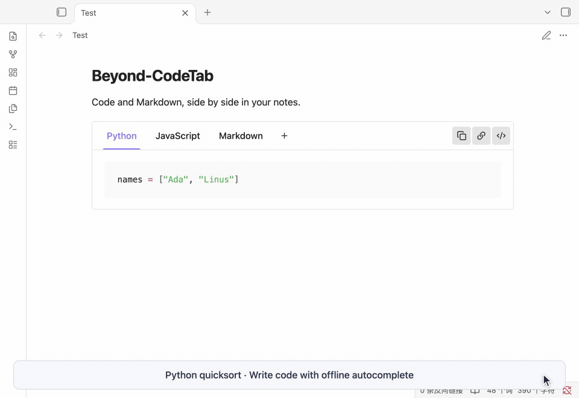
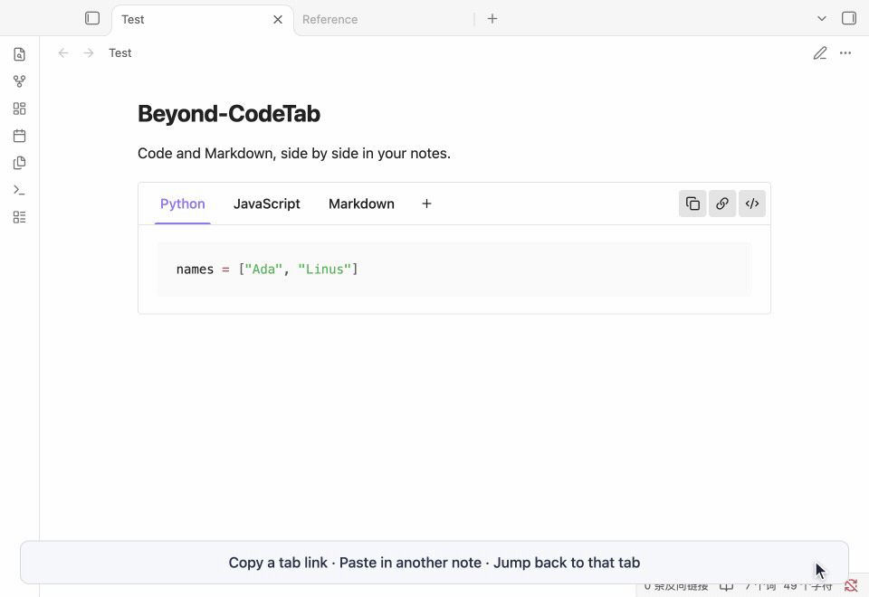
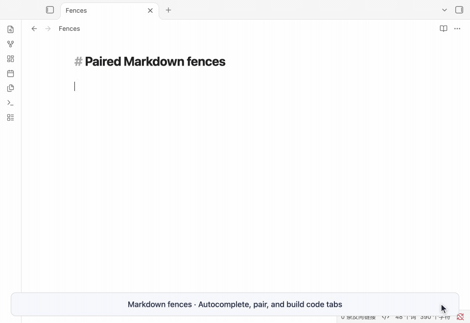

# Beyond-CodeTab: extend Obsidian's native code blocks with tabs

Beyond-CodeTab is an Obsidian plugin that extends native code blocks with code tabs.

Organize Markdown, code, and tables into switchable tabs to keep related parts of a note together in one place.

Use it for:

- Mathematical theorems and related explanations.
- Multiple Excalidraw diagrams.
- LeetCode solutions: different approaches to one problem, or implementations of the same algorithm in several languages.

<p align="center">
  <a href="../README.md">中文</a> ·
  <a href="README.en.md">English</a> ·
  <a href="README.ja.md">日本語</a> ·
  <a href="README.ko.md">한국어</a>
</p>

<p align="center">
  <a href="#gif-demos">GIF demos</a> ·
  <a href="../docs/community.md">Community and discovery</a> ·
  <a href="https://github.com/volmodaoist/Beyond-CodeTab/issues/new/choose">Report an issue</a>
</p>

Project: [volmodaoist/Beyond-CodeTab](https://github.com/volmodaoist/Beyond-CodeTab) · Author: [volmodaoist](https://github.com/volmodaoist) · License: [MIT](../LICENSE)

## 🎉 Features

Each tab supports:

- 👀 **Direct editing and tab management**:
  - Double-click to rename, or right-click to delete.
  - Add, switch, and drag to reorder tabs. Changes are written back to Markdown.
  - Click content to edit in place. The editor grows and shrinks with the text.
- 🧩 **More than code blocks**:
  - Use Markdown, tables, images, note embeds, and content from other plugins, including Excalidraw drawings.
  - With Excalidraw Frame Deck, a standalone drawing embed containing multiple frames can be browsed like presentation slides. [Details](../docs/feat/excalidraw-frame-deck.md).
  - Code tabs offer configurable completion beyond the native code block experience. Built-in word lists cover Java, C, C++, Python, JavaScript, TypeScript, Go, and Shell.
  - Add your own dictionaries and rules for other languages or project-specific terms. The portable completion core can be copied into another project; credit the original author's contribution when reusing it.
- ⚡️ **Three buttons in the tab bar**:
  - Copy the complete content of the current tab.
  - Copy a reference that opens this specific tab.
  - Open the source of the entire tab group.
- 🤖 **[Public API](../src/openapi/api-doc.md)**: other plugins can embed tab groups, synchronize content, and take control of persistence.

## 🎯 Installation and updates

Building requires Node.js 20 or later. Run these commands from the repository root:

```bash
npm ci
npm run build
```

These commands only produce files in this repository's `dist/` directory. To install manually:

1. Create `.obsidian/plugins/obsidian-code-tab/` in the destination Vault.
2. Copy `dist/main.js`, `dist/manifest.json`, and `dist/styles.css` into that directory.
3. Enable **Beyond-CodeTab** in Obsidian's Settings → Community plugins. To load an update, disable and enable the plugin again, or restart Obsidian.

You can also use Make. Run `make` at the repository root to see the available commands:

```bash
make build                   # Type-check and build
make check                   # Core tests, build, lint, and documentation checks
make lint-fix                # Fix code formatting
make test-obsidian           # Run real Obsidian regression tests
make demos                   # Record the GIFs below; requires FFmpeg
make docs-check              # Check document links, anchors, and GIFs
make install vault="/path/to/your/vault"
```

The installer uses `vault="..."` to select the destination. It runs `npm ci` if build dependencies are missing, builds the current source, replaces the three runtime files, and preserves plugin settings by default.

<a id="gif-demos"></a>

## 👀 GIF demos

### Organize content with tabs



### Configurable code completion



### Link directly to a tab



### Paired fences and autocomplete



See the [recording guide](../docs/assets/demos/README.md) for commands, capture details, and how to regenerate the demos.

## 🚀 Quick start

### Create Markdown tabs

Create a fenced block with the language `tab`, and start each tab with `tab: Title` on its own line. This example produces two tabs, “Introduction” and “Notes”:

````markdown
```tab
tab: Introduction
Write ordinary **Markdown** here.

tab: Notes
- First item
- Second item
```
````

### Organize code blocks into tabs

Inner code blocks normally use three backticks, so use four backticks for the outer `tab` block:

`````markdown
````tab
tab: Python
```python
def greet(name: str) -> str:
    return f"Hello, {name}!"
```

tab: JavaScript
```javascript
function greet(name) {
  return `Hello, ${name}!`;
}
```
````
`````

Three- and four-backtick fences support pairing and completion. Pasting four backticks and pressing Enter also creates the matching closing fence. Changes to both ends can be undone together. Keep the outer fence longer than any inner fence of the same kind; pairing follows Markdown's nesting rules, and saving also protects the outer fence based on the inner fence lengths.

Language aliases such as `c++` are supported. During preview, the alias is mapped in memory to Prism's `cpp`:

````markdown
```c++
#include <stdio.h>

int main() {
    return 0;
}
```
````

### Create tabs from the command palette

Open the command palette and run the following command, whose current UI label is in Chinese:

```text
Beyond-CodeTab: 创建标签组件
```

The command inserts a two-tab template at the cursor. Additional tabs use the next available names, such as “标签3” and “标签4”, and contain an empty `text` code block. Click the new block to start writing directly in the note.

### Edit content

1. Select the tab you want to edit in Reading view.
2. Click its content to enter the native Markdown editor.
3. Use the `</>` button at the top right to open the entire group's source, including its outer fence and all `tab:` declarations.
4. Move the pointer outside the content to save and return to the preview.

### Copy content and reference a tab

The reference button copies a Markdown link. Paste it into another note to locate the group and select the corresponding tab. Creating the first reference saves two identifiers in the source note:

- **Group block ID**: a six-character ID on a separate line after the outer closing fence, for example `^a1b2c3`.
- **Stable tab ID**: the group ID plus a six-character tab ID, appended to the title line, for example `tab: Python ^a1b2c3-d4e5f6`. Only the title appears in the UI. Renaming, editing, and reordering preserve the ID; copying the tab content omits this metadata.
- Deleting a tab makes its old references report that the target no longer exists.

The group ID is a native Obsidian block identifier, while Beyond-CodeTab parses the tab IDs:

`````markdown
````tab
tab: Python ^a1b2c3-d4e5f6
Python tab content goes here.

tab: Shell ^a1b2c3-112233
Shell tab content goes here.
````
^a1b2c3
`````

The dedicated link includes the group ID and the tab ID:

```markdown
[Python](obsidian://beyond-code-tab?block=a1b2c3&tab=d4e5f6)
```

The group ID also works with native links and embeds such as `[[Example#^a1b2c3]]` and `![[Example#^a1b2c3]]`. Those address the entire group; the dedicated link additionally selects a tab. Native block IDs accept letters, digits, and hyphens. A code block's ID belongs on a separate line outside its closing fence.

- Tab references navigate to content. They remain valid after renaming or moving a note, or renaming the Vault.
- A reference copied to another Vault can resolve there if the plugin is installed and that Vault contains the corresponding tab group.

### Code completion

While editing a code tab, type a word prefix to show candidates, or press `Ctrl + Space` to request them. Completion applies to code block bodies. Use the bottom-right type field for a single code block; in mixed Markdown, each code block uses its own fence language.

| Language | Common aliases | Example |
| --- | --- | --- |
| Java | `java` | `pub` → `public` |
| C | `c` | `pri` → `printf` |
| C++ | `cpp`, `c++`, `cc`, `cxx` | `vec` → `vector` |
| Python | `python`, `python3`, `py` | `enu` → `enumerate` |
| JavaScript | `javascript`, `js`, `jsx` | `con` → `const` |
| TypeScript | `typescript`, `ts`, `tsx` | `key` → `keyof` |
| Go | `go`, `golang` | `def` → `defer` |
| Shell | `shell`, `sh`, `bash`, `zsh` | `ech` → `echo` |

To add dictionaries and rules, open Settings → Beyond-CodeTab, paste this JSON into **自定义代码补全** (custom code completion), and click **应用补全配置** (apply completion configuration):

```json
{
  "wordLists": [
    {
      "id": "my-commands",
      "languages": ["shell"],
      "words": [
        "deployLocal",
        { "label": "greet", "insertText": "echo hello", "detail": "Print a greeting" }
      ]
    }
  ],
  "rules": [
    {
      "id": "docker-commands",
      "languages": ["shell"],
      "match": "docker\\s+\\w*$",
      "words": ["composeLocal"]
    }
  ]
}
```

The example shows three completion patterns:

- **Word completion**: type `depl` in Shell code and select `deployLocal`.
- **Custom insertion**: type `gre` and select `greet` to insert `echo hello`. `label` controls display and prefix matching; `insertText` controls the inserted text.
- **Rule-based completion**: type `docker co` and select the rule entry to get `docker composeLocal`. `match` checks the current line before the cursor; by default, only the current word is replaced. In JSON, write a literal backslash as `\\`.

Each entry needs a unique `id`, its `languages`, and its `words`. If you need help preparing a configuration, give this document to your coding agent. A configuration is saved and applied only after validation; invalid input preserves the previous settings.

Completion uses offline dictionaries and rules. It does not perform type inference, automatic imports, or LSP queries.

Apply `{"wordLists": [], "rules": []}` to clear custom entries while keeping the built-in dictionaries. See the [completion core guide](../docs/feat/code-completion-core.md) for configuration and function rules.

## ⌨️ Shortcuts and controls

| Action | Result |
| --- | --- |
| Click content | Start editing |
| `+` at the end of the tab bar | Save the edit, then add and select an empty code tab |
| Drag a tab title | Reorder tabs and write the change to Markdown |
| Double-click a title | Rename; Enter or blur saves, Esc cancels |
| Right-click a tab → delete | Confirm deletion of the tab and its content |
| Bottom-right type field while editing | Enter a language, `markdown`, or a plugin processor name; Enter returns to the content |
| Move the pointer outside content | Save and return to preview |
| `Ctrl/Cmd + Enter` | Save immediately and return to preview |
| `Esc` | Close completion first; press again to cancel the edit |
| `←` / `→` | Switch tabs when a title has focus |
| `Home` / `End` | Select the first or last tab |

The bottom-right field controls the tab's **rendering type**, which can be more than a programming language:

| Type | Display after saving |
| --- | --- |
| `markdown` / `md` | Markdown tables, prose, code blocks, and embeds |
| `python`, `javascript`, `c++`, `c#`, etc. | Syntax-highlighted code |
| `mermaid` or an installed plugin's processor name | Content rendered by Obsidian's registered processor |
| Empty, `text`, or an unregistered type | Plain text in a code block |

Tabs can contain a Markdown table directly, or wrap it in an `md` / `markdown` fence. Drawings use standard Obsidian embed syntax:

`````markdown
```tab
tab: Table
| Identifier | Description |
| --- | --- |
| intent_id | One rebalancing intent |

tab: Drawing
![[Drawing.excalidraw.md]]
```
`````

The drawing file must exist in the Vault and Excalidraw must be enabled. Clicking the drawing is handled by Excalidraw. Click the surrounding panel whitespace to edit the embed link. Entering `excalidraw` alone does not create a drawing or install its plugin.

The editor grows and shrinks with its content; long content scrolls with the page. Typing and page scrolling do not trigger autosave. Moving the pointer outside the content or explicitly saving commits the edit. Moving into a completion popup keeps the edit session open.

<a id="faq"></a>

## ⁉️ Common questions

**Tabs do not appear:** use a `tab` fence and put each `tab:` declaration on its own line. When tabs contain triple-backtick blocks, use four backticks for the outer fence. Reading view and Live Preview render the tabs; Source mode shows Markdown.

**An update still shows the old name or behavior:** replace the files in the current Vault's plugin directory, then disable and enable the plugin. `npm run build` and `npm run dev` only update this repository's `dist/`; they do not install to a Vault.

**Completion does not appear:** enter the code editor, check the language, and try `Ctrl + Space`. Esc first closes an open completion list, then cancels editing on the next press.

**Saving reports a conflict:** another pane or a sync tool may have changed the note. The plugin refuses to overwrite a block whose original content cannot be found and keeps your draft. Copy what you need, cancel, and reopen the latest content before editing again.

Additional editing details:

- A tab title cannot be empty and is always displayed as plain text.
- Changing a code language updates highlighting while editing. Do not put whitespace, backticks, or tildes that would break the fence into the type field.
- Esc cancels both content and type changes. Converting a Markdown tab to code wraps its entire content in a code fence.
- Save before switching tabs during an edit, so switching and asynchronous persistence cannot race. Move the pointer outside the content to save first. A failed save preserves the draft.
- Delete confirmation focuses “Cancel” by default. Closing it or pressing Esc keeps the tab. Deleting an inactive tab preserves the current selection; deleting the active tab selects a neighbor. Deleting the last tab removes the whole group, as stated in the confirmation.

## 🧑‍💻 Development and plugin integration

| Need | Documentation |
| --- | --- |
| Embed groups, get type hints, modify data, and handle saves | [API reference](../src/openapi/api-doc.md) |
| Synchronization, conflicts, read-only state, and lifecycle | [Host rendering contract](../docs/host-rendering.md) |
| Use completion in another editor | [Portable core README](../src/core/completion/README.md) |
| Read the source, develop, and debug locally | [Plugin development guide](../docs/tech/obsidian-plugin-development-guide.md) |
| Browse all topics | [Documentation index](../docs/README.md) |

Supporting development documents are primarily in Chinese. Common checks:

```bash
npm run lint
npm test
npm run build
npm run test:obsidian
```

The first three commands run without Obsidian. The last requires a local Obsidian installation and uses an isolated temporary Vault to check real editing, layout, and file writes. See the [test guide](../tests/test-guide.md) and [development conventions](../AGENTS.md).

<a id="credits"></a>

## 🎨 Sharing and credits

Maintainer: [volmodaoist](https://github.com/volmodaoist). Repository: [Beyond-CodeTab](https://github.com/volmodaoist/Beyond-CodeTab).

This project grew from a fork of the upstream code through several rounds of changes. Thanks to the original project and its author:

- Upstream: [lazyloong/obsidian-code-tab](https://github.com/lazyloong/obsidian-code-tab)
- Upstream version: `2.0-alpha`
- Original author: lazyloong
- License: MIT
