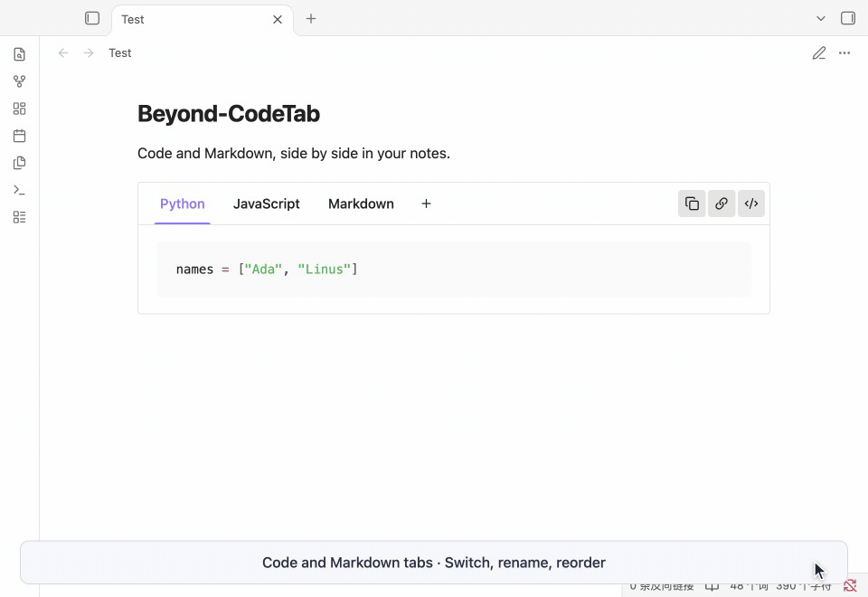
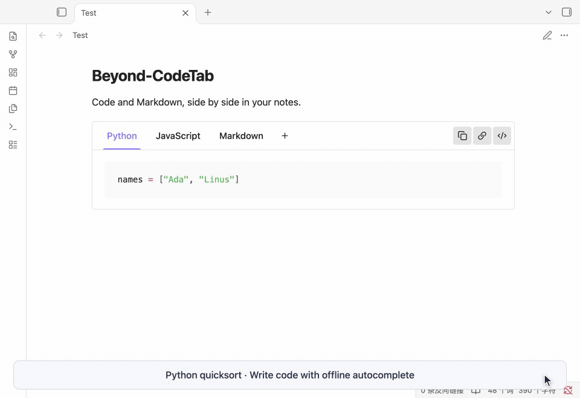
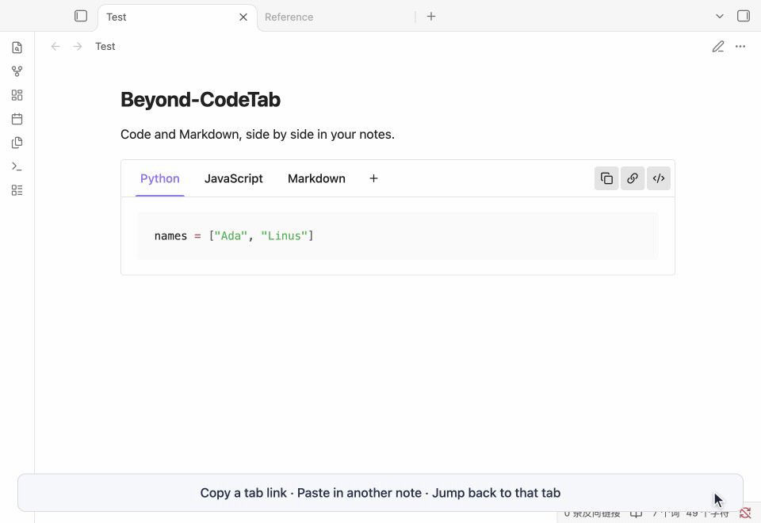
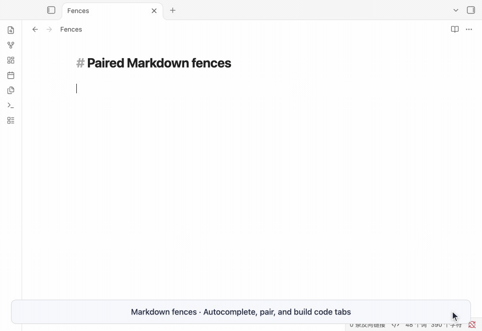

# Beyond-CodeTab：Obsidian 標準のコードブロックをタブで拡張

Beyond-CodeTab は、Obsidian 標準のコードブロックを拡張し、コードをタブでまとめられるようにするプラグインです。

Markdown、コード、表を切り替え可能なタブに整理し、関連する内容をノートの同じ場所にまとめられます。

たとえば、次のような使い方ができます。

- 数学の定理とその説明を整理する。
- 複数の Excalidraw 図を並べて切り替える。
- LeetCode の同じ問題に対する複数の解法や、同じアルゴリズムの言語別実装をまとめる。

<p align="center">
  <a href="../README.md">中文</a> ·
  <a href="README.en.md">English</a> ·
  <a href="README.ja.md">日本語</a> ·
  <a href="README.ko.md">한국어</a>
</p>

<p align="center">
  <a href="#gif-demos">GIF デモ</a> ·
  <a href="../docs/community.md">コミュニティ・検索</a> ·
  <a href="https://github.com/volmodaoist/Beyond-CodeTab/issues/new/choose">不具合の報告</a>
</p>

プロジェクト：[volmodaoist/Beyond-CodeTab](https://github.com/volmodaoist/Beyond-CodeTab) · 作者：[volmodaoist](https://github.com/volmodaoist) · ライセンス：[MIT](../LICENSE)

## 🎉 主な機能

各タブで次の機能を利用できます。

- 👀 **その場で編集・管理**
  - タイトルをダブルクリックして名前を変更し、右クリックから削除できます。
  - 追加、切り替え、ドラッグによる並べ替えに対応し、変更は Markdown に保存されます。
  - 内容をクリックして直接編集できます。編集領域は文章量に合わせて伸縮します。
- 🧩 **コード以外の内容にも対応**
  - 通常の Markdown、表、画像、ノートの埋め込み、Excalidraw など他のプラグインの埋め込みを扱えます。
  - Excalidraw Frame Deck は、単独で埋め込んだ図に複数の Frame がある場合、スライドのようにページを切り替えて表示します。[詳細](../docs/feat/excalidraw-frame-deck.md)。
  - コードタブでは、標準のコードブロックに加えて、設定可能な補完を利用できます。Java、C、C++、Python、JavaScript、TypeScript、Go、Shell の辞書を内蔵しています。
  - 独自の辞書やルールを追加できます。補完 Core は独立したモジュールとして別のプロジェクトへコピーでき、再利用時には元の作者の貢献を明記してください。
- ⚡️ **タブバー右側の 3 つのボタン**
  - 現在のタブの内容全体をコピー。
  - 特定のタブへ移動できる参照リンクをコピー。
  - タブグループ全体のソースを開く。
- 🤖 **[公開 API](../src/openapi/api-doc.md)**：他のプラグインからタブグループを埋め込み、内容を同期し、保存処理を管理できます。

## 🎯 インストールと更新

ビルドには Node.js 20 以降が必要です。リポジトリのルートで実行します。

```bash
npm ci
npm run build
```

このコマンドはリポジトリ内の `dist/` にビルド結果を生成します。手動でインストールする場合は、次の手順を実行してください。

1. インストール先の Vault に `.obsidian/plugins/obsidian-code-tab/` を作成します。
2. `dist/main.js`、`dist/manifest.json`、`dist/styles.css` をそのフォルダーへコピーします。
3. Obsidian の「設定 → コミュニティプラグイン」で **Beyond-CodeTab** を有効にします。更新後は、プラグインを一度無効にしてから再度有効にするか、Obsidian を再起動してください。

Make でのインストールにも対応しています。リポジトリのルートで `make` を実行すると、利用できるコマンドを確認できます。

```bash
make build                   # 型チェックとビルド
make check                   # Core テスト、ビルド、lint、ドキュメント検証
make lint-fix                # コードの書式を修正
make test-obsidian           # 実際の Obsidian で回帰テスト
make demos                   # 下記 GIF を録画。FFmpeg が必要
make docs-check              # リンク、アンカー、GIF を検証
make install vault="/path/to/your/vault"
```

`vault="..."` でインストール先を指定します。ビルド依存関係が不足している場合は `npm ci` を実行し、現在のソースをビルドします。実行に必要な 3 ファイルを置き換え、既存のプラグイン設定は保持します。

<a id="gif-demos"></a>

## 👀 GIF デモ

### タブで内容を整理する



### カスタマイズ可能なコード補完



### 特定のタブを参照する



### フェンスの補完とペア編集



録画コマンド、素材の取得方法、再生成手順は[録画ガイド](../docs/assets/demos/README.md)をご覧ください。

## 🚀 はじめに

### Markdown タブを作成する

言語名を `tab` にしたコードフェンスを作成し、各タブの先頭を独立した `tab: タイトル` 行で区切ります。次の例では「概要」と「注意事項」の 2 つのタブが表示されます。

````markdown
```tab
tab: 概要
通常の **Markdown** を書けます。

tab: 注意事項
- 項目 1
- 項目 2
```
````

### コードブロックを複数のタブにまとめる

内側のコードブロックには通常 3 個のバッククォートを使うため、外側の `tab` ブロックには 4 個を使います。

`````markdown
````tab
tab: Python
```python
def greet(name: str) -> str:
    return f"Hello, {name}!"
```

tab: JavaScript
```javascript
function greet(name) {
  return `Hello, ${name}!`;
}
```
````
`````

3 個・4 個のバッククォートに対して、フェンスのペア編集と補完が働きます。4 個のバッククォートを入力または貼り付けて Enter を押すと、対応する終了フェンスも生成されます。両端の変更はまとめて取り消せます。外側のフェンスは、内側にある同じ種類のフェンスより長くしてください。自動補完も Markdown の入れ子規則に従い、保存時には内側の長さに合わせて外側を保護します。

言語名には `c++` のような別名も使えます。プレビュー時は、Prism が認識する `cpp` にメモリ上で変換します。

````markdown
```c++
#include <stdio.h>

int main() {
    return 0;
}
```
````

### コマンドパレットから作成する

コマンドパレットで次を実行します。プラグイン内のコマンド名は現在、中国語表記です。

```text
Beyond-CodeTab: 创建标签组件
```

カーソル位置に 2 つのタブを含むテンプレートが挿入されます。追加するタブには「标签3」「标签4」など未使用の名前が付き、空の `text` コードブロックが作られます。そのコードブロックをクリックすると、ノートのソースを書き換えずに入力を始められます。

### 内容を編集する

1. 閲覧ビューで編集したいタブを選択します。
2. 内容をクリックして、ネイティブの Markdown 編集状態に切り替えます。
3. 右上の `</>` は、外側のフェンスとすべての `tab:` 宣言を含むグループ全体のソースを開きます。
4. ポインターを内容の外へ移動すると、保存してプレビューに戻ります。

### コピーとタブ参照

参照ボタンは Markdown リンクを生成してコピーします。別のノートへ貼り付けると、グループへ移動して指定したタブを選択できます。最初の参照を作成すると、元のノートに次の識別子が保存されます。

- **グループのブロック ID**：6 文字の ID を外側の終了フェンス後の独立した行に置きます。例：`^a1b2c3`。
- **タブの固定 ID**：グループの 6 文字 ID とタブの 6 文字 ID を組み合わせ、タイトル行末に付けます。例：`tab: Python ^a1b2c3-d4e5f6`。画面にはタイトルだけが表示されます。名前の変更、内容の編集、並べ替えでも ID は保持され、内容をコピーする際にはこのメタデータを含めません。
- タブを削除すると、古い参照は対象が存在しないことを通知します。

グループ ID は Obsidian 標準のブロック識別子です。内側のタブ ID は Beyond-CodeTab が解析します。

`````markdown
````tab
tab: Python ^a1b2c3-d4e5f6
ここに Python タブの内容を書きます。

tab: Shell ^a1b2c3-112233
ここに Shell タブの内容を書きます。
````
^a1b2c3
`````

専用リンクにはグループ ID とタブ ID が含まれます。

```markdown
[Python](obsidian://beyond-code-tab?block=a1b2c3&tab=d4e5f6)
```

グループ ID は `[[Example#^a1b2c3]]` や `![[Example#^a1b2c3]]` にも使えます。これらはグループ全体を参照・埋め込みし、専用リンクはさらに特定のタブを選択します。標準のブロック ID に使える文字は英字、数字、ハイフンです。コードブロックの ID は終了フェンスの外側の独立した行に置いてください。

- タブ参照は移動用のリンクです。ノートの移動、名前の変更、Vault 名の変更後も再作成する必要はありません。
- 別の Vault にコピーした参照も、その Vault にプラグインと対応するタブグループがあれば移動できます。

### コード補完

コードタブの編集時に単語の先頭を入力すると候補が表示されます。`Ctrl + Space` でも補完を呼び出せます。補完対象はコードブロックの本文です。単一コードブロックでは右下の種類フィールドを使い、複数のコードブロックを含む Markdown では、それぞれのフェンスの言語名を使います。

| 言語 | よく使う別名 | 例 |
| --- | --- | --- |
| Java | `java` | `pub` → `public` |
| C | `c` | `pri` → `printf` |
| C++ | `cpp`, `c++`, `cc`, `cxx` | `vec` → `vector` |
| Python | `python`, `python3`, `py` | `enu` → `enumerate` |
| JavaScript | `javascript`, `js`, `jsx` | `con` → `const` |
| TypeScript | `typescript`, `ts`, `tsx` | `key` → `keyof` |
| Go | `go`, `golang` | `def` → `defer` |
| Shell | `shell`, `sh`, `bash`, `zsh` | `ech` → `echo` |

独自の辞書やルールを追加するには、「設定 → Beyond-CodeTab」の **自定义代码补全**（カスタムコード補完）に JSON を貼り付け、**应用补全配置**（補完設定を適用）をクリックします。

```json
{
  "wordLists": [
    {
      "id": "my-commands",
      "languages": ["shell"],
      "words": [
        "deployLocal",
        { "label": "greet", "insertText": "echo hello", "detail": "挨拶を表示" }
      ]
    }
  ],
  "rules": [
    {
      "id": "docker-commands",
      "languages": ["shell"],
      "match": "docker\\s+\\w*$",
      "words": ["composeLocal"]
    }
  ]
}
```

この例では 3 種類の補完を設定しています。

- **単語補完**：Shell コードで `depl` と入力し、`deployLocal` を選択します。
- **挿入内容の指定**：`gre` と入力して `greet` を選ぶと、`echo hello` が挿入されます。`label` は表示と先頭一致に使い、`insertText` は実際の挿入内容を指定します。
- **ルールによる補完**：`docker co` と入力して候補を選ぶと、`docker composeLocal` になります。`match` はカーソル直前の現在行を判定し、既定では入力中の単語だけを置き換えます。JSON のバックスラッシュは `\\` と記述してください。

各項目には、一意の `id`、対象の `languages`、`words` が必要です。設定が難しい場合は、このドキュメントをコーディングエージェントに渡して作成を依頼できます。検証に成功した設定だけを保存・適用し、無効な設定では以前の状態を保持します。

補完はオフラインの辞書とルールを使い、型推論、自動インポート、LSP 問い合わせは行いません。

`{"wordLists": [], "rules": []}` を適用すると、組み込み辞書を残したままカスタム設定を消去できます。設定形式と関数ルールは[補完 Core ガイド](../docs/feat/code-completion-core.md)をご覧ください。

## ⌨️ ショートカットと操作

| 操作 | 結果 |
| --- | --- |
| 内容をクリック | 編集を開始 |
| タブバー末尾の `+` | 編集を保存し、空のコードタブを追加・選択 |
| タイトルをドラッグ | 並べ替えて Markdown に保存 |
| タイトルをダブルクリック | 名前を変更。Enter またはフォーカス解除で保存、Esc で中止 |
| タブを右クリック → 削除 | 確認後にタブと内容を削除 |
| 編集時の右下の種類フィールド | 言語、`markdown`、プラグインの処理名を入力。Enter で本文へ戻る |
| ポインターを内容の外へ移動 | 保存してプレビューへ戻る |
| `Ctrl/Cmd + Enter` | すぐに保存してプレビューへ戻る |
| `Esc` | 補完候補を閉じ、もう一度押すと編集を破棄 |
| `←` / `→` | タイトルにフォーカスがあるときタブを切り替える |
| `Home` / `End` | 最初・最後のタブを選択 |

右下のフィールドはタブ全体の**表示形式**を指定します。プログラミング言語以外も使えます。

| 種類 | 保存後の表示 |
| --- | --- |
| `markdown` / `md` | Markdown の表、文章、コードブロック、埋め込み |
| `python`, `javascript`, `c++`, `c#` など | シンタックスハイライト付きコード |
| `mermaid` またはインストール済みプラグインの処理名 | Obsidian に登録されたレンダラーで表示 |
| 空欄、`text`、未登録の種類 | プレーンテキストのコードブロック |

タブ本文に Markdown の表を直接書くことも、`md` / `markdown` フェンスで囲むこともできます。図には Obsidian 標準の埋め込み構文を使います。

`````markdown
```tab
tab: 表
| 識別子 | 説明 |
| --- | --- |
| intent_id | 1 件のリバランス指示 |

tab: 図
![[Drawing.excalidraw.md]]
```
`````

図のファイルが Vault 内に存在し、Excalidraw が有効になっている必要があります。図のクリックは Excalidraw が処理します。パネル周辺の余白をクリックすると、埋め込みリンクを編集できます。`excalidraw` と入力するだけでは、図の作成やプラグインのインストールは行われません。

編集領域は内容に合わせて伸縮し、長い内容はページ全体でスクロールします。入力やページのスクロールでは自動保存を行いません。ポインターを内容の外へ移動するか、保存ショートカットを使うと確定します。補完候補へポインターを移動しても編集状態は維持されます。

<a id="faq"></a>

## ⁉️ よくある質問

**タブが表示されない**：`tab` フェンスを使い、各 `tab:` 宣言を独立した行に置いてください。内側に 3 個のバッククォートのコードブロックがある場合、外側は 4 個にします。閲覧ビューとライブプレビューではタブを表示し、ソースモードでは Markdown を表示します。

**更新後も古い名前や動作のまま**：現在の Vault のプラグインフォルダーを更新し、プラグインを一度無効にして再度有効にしてください。`npm run build` と `npm run dev` はリポジトリ内の `dist/` だけを更新します。

**補完が表示されない**：コードの編集状態に入り、言語名を確認して `Ctrl + Space` を試してください。候補が開いている場合、Esc は最初に候補を閉じ、次に編集を中止します。

**保存時に競合が通知される**：別のペインや同期ツールがノートを更新した可能性があります。元の内容が見つからないブロックを上書きせず、下書きを保持します。必要な内容をコピーし、編集を中止して最新のノートを開き直してください。

その他の編集上の注意：

- タイトルを空にすることはできず、表示は常にプレーンテキストです。
- 言語の変更は編集中のハイライトにも反映されます。種類フィールドには、フェンスを壊す空白、バッククォート、チルダを入力しないでください。
- Esc は本文と種類の変更を両方破棄します。Markdown タブをコードに変換すると、本文全体をコードフェンスで囲みます。
- 編集中は保存してから別のタブへ切り替えてください。内容の外へポインターを移動すると保存されます。保存が失敗しても下書きは保持されます。
- 削除確認では既定で「キャンセル」にフォーカスします。閉じるか Esc を押すと削除しません。非アクティブなタブを削除しても現在の選択を保ち、選択中のタブを削除すると隣のタブを選びます。最後のタブを削除するとグループ全体が消え、その旨を確認画面に表示します。

## 🧑‍💻 開発とプラグイン連携

| 目的 | ドキュメント |
| --- | --- |
| タブの埋め込み、型ヒント、データ操作、保存コールバック | [API リファレンス](../src/openapi/api-doc.md) |
| 同期、競合、読み取り専用状態、ライフサイクル | [ホスト描画契約](../docs/host-rendering.md) |
| 別のエディターで補完を使う | [独立 Core の README](../src/core/completion/README.md) |
| ソースの理解、開発、ローカルデバッグ | [プラグイン開発ガイド](../docs/tech/obsidian-plugin-development-guide.md) |
| 全体のトピックを調べる | [ドキュメント一覧](../docs/README.md) |

リンク先の開発ドキュメントは主に中国語です。検証コマンド：

```bash
npm run lint
npm test
npm run build
npm run test:obsidian
```

最初の 3 つは Obsidian がなくても実行できます。最後のコマンドにはローカルの Obsidian が必要で、独立した一時 Vault で実際の編集、レイアウト、ファイル保存を検証します。[テストガイド](../tests/test-guide.md)と[開発規約](../AGENTS.md)をご覧ください。

<a id="credits"></a>

## 🎨 共有と謝辞

メンテナー：[volmodaoist](https://github.com/volmodaoist)。リポジトリ：[Beyond-CodeTab](https://github.com/volmodaoist/Beyond-CodeTab)。

本プロジェクトは、上流コードのフォークを基に複数回の改良を重ねて作られました。元のプロジェクトと作者に感謝します。

- 上流：[lazyloong/obsidian-code-tab](https://github.com/lazyloong/obsidian-code-tab)
- 上流バージョン：`2.0-alpha`
- 元の作者：lazyloong
- ライセンス：MIT
