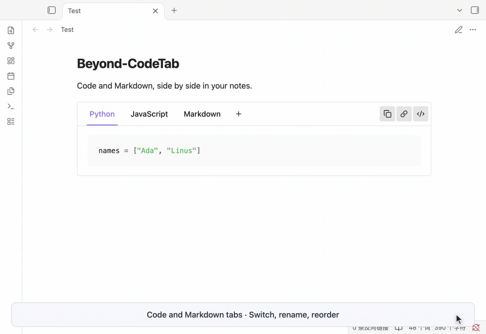
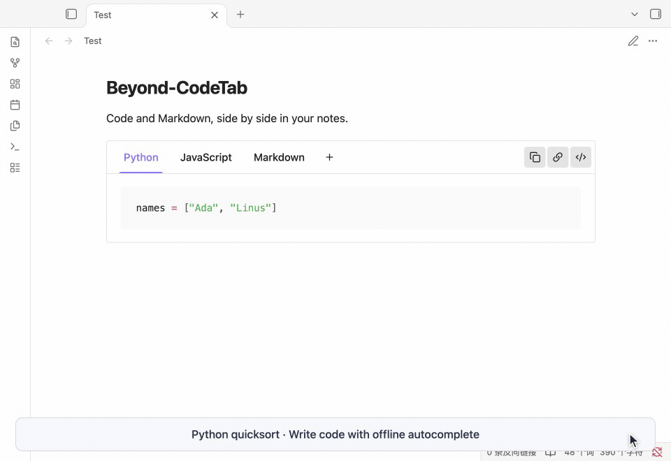
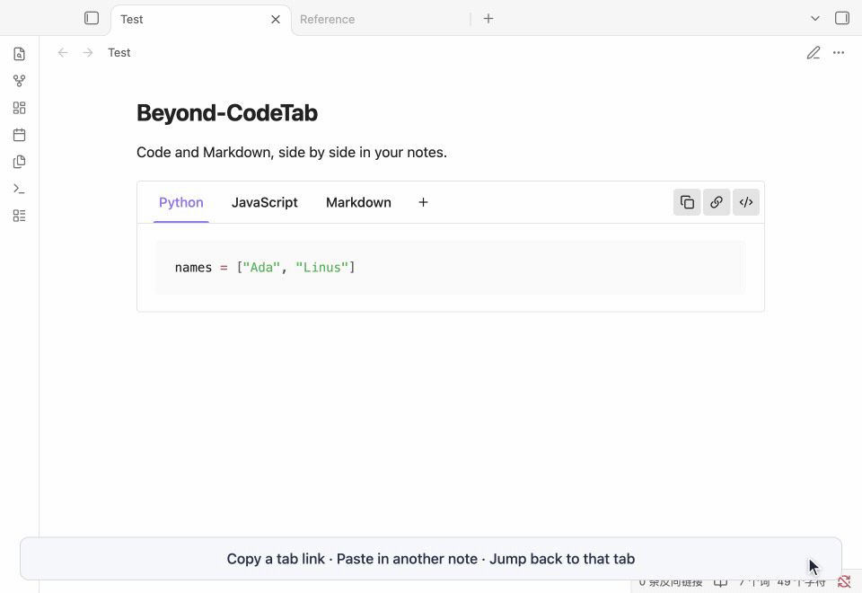
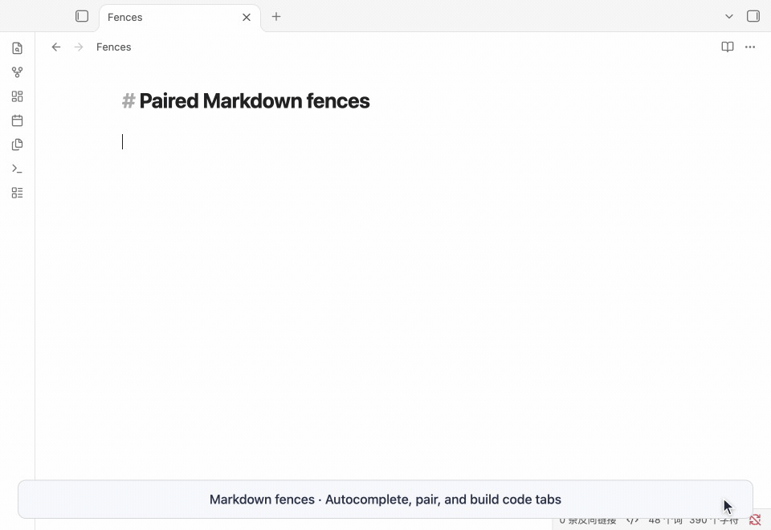

# Beyond-CodeTab: Obsidian 기본 코드 블록을 탭으로 확장

Beyond-CodeTab은 Obsidian의 기본 코드 블록을 확장하여 코드를 탭으로 구성할 수 있게 해 주는 플러그인입니다.

Markdown, 코드, 표를 전환 가능한 탭으로 정리해 서로 관련된 내용을 노트의 한곳에 모을 수 있습니다.

이런 용도로 활용할 수 있습니다.

- 수학 정리와 관련 설명 정리
- 여러 Excalidraw 다이어그램 비교
- LeetCode 문제의 여러 풀이, 또는 같은 알고리즘의 언어별 구현 정리

<p align="center">
  <a href="../README.md">中文</a> ·
  <a href="README.en.md">English</a> ·
  <a href="README.ja.md">日本語</a> ·
  <a href="README.ko.md">한국어</a>
</p>

<p align="center">
  <a href="#gif-demos">GIF 데모</a> ·
  <a href="../docs/community.md">커뮤니티와 검색</a> ·
  <a href="https://github.com/volmodaoist/Beyond-CodeTab/issues/new/choose">문제 보고</a>
</p>

프로젝트: [volmodaoist/Beyond-CodeTab](https://github.com/volmodaoist/Beyond-CodeTab) · 작성자: [volmodaoist](https://github.com/volmodaoist) · 라이선스: [MIT](../LICENSE)

## 🎉 주요 기능

각 탭에서 다음 기능을 사용할 수 있습니다.

- 👀 **직접 편집하고 관리하기**
  - 제목을 두 번 클릭해 이름을 바꾸고, 우클릭 메뉴에서 삭제할 수 있습니다.
  - 탭 추가, 전환, 드래그 정렬을 지원하며 변경 내용은 Markdown에 저장됩니다.
  - 내용을 클릭하면 그 자리에서 편집할 수 있습니다. 편집 영역은 내용의 길이에 맞춰 늘어나거나 줄어듭니다.
- 🧩 **코드 외의 다양한 콘텐츠**
  - 일반 Markdown, 표, 이미지, 노트 임베드와 Excalidraw 같은 다른 플러그인의 임베드를 지원합니다.
  - Excalidraw Frame Deck을 사용하면 여러 Frame이 있는 단일 그림 임베드를 슬라이드처럼 넘겨 볼 수 있습니다. [자세히 보기](../docs/feat/excalidraw-frame-deck.md).
  - 코드 탭은 기본 코드 블록에 더해 설정 가능한 자동 완성을 제공합니다. Java, C, C++, Python, JavaScript, TypeScript, Go, Shell 단어 목록이 내장되어 있습니다.
  - 원하는 언어나 프로젝트 용어에 맞춰 단어 목록과 규칙을 추가할 수 있습니다. 자동 완성 Core는 독립 모듈로 다른 프로젝트에 복사해 사용할 수 있으며, 재사용 시 원저자의 기여를 명시해 주세요.
- ⚡️ **탭 표시줄 오른쪽의 세 가지 버튼**
  - 현재 탭의 전체 내용 복사
  - 특정 탭으로 이동하는 참조 링크 복사
  - 탭 그룹 전체의 소스 열기
- 🤖 **[공개 API](../src/openapi/api-doc.md)**: 다른 플러그인이 탭 그룹을 임베드하고, 내용을 동기화하며, 저장 처리를 직접 관리할 수 있습니다.

## 🎯 설치와 업데이트

빌드하려면 Node.js 20 이상이 필요합니다. 저장소 루트에서 실행하세요.

```bash
npm ci
npm run build
```

이 명령은 저장소의 `dist/`에 빌드 결과만 생성합니다. 수동으로 설치하려면 다음 절차를 따르세요.

1. 대상 보관소(Vault)에 `.obsidian/plugins/obsidian-code-tab/` 폴더를 만듭니다.
2. `dist/main.js`, `dist/manifest.json`, `dist/styles.css`를 해당 폴더에 복사합니다.
3. Obsidian의 설정 → 커뮤니티 플러그인에서 **Beyond-CodeTab**을 활성화합니다. 업데이트 후에는 플러그인을 비활성화했다가 다시 활성화하거나 Obsidian을 다시 시작하세요.

Make로도 설치할 수 있습니다. 저장소 루트에서 `make`를 실행하면 사용할 수 있는 명령을 확인할 수 있습니다.

```bash
make build                   # 타입 검사와 빌드
make check                   # Core 테스트, 빌드, lint, 문서 검사
make lint-fix                # 코드 서식 자동 수정
make test-obsidian           # 실제 Obsidian 회귀 테스트
make demos                   # 아래 GIF 녹화. FFmpeg 필요
make docs-check              # 문서 링크, 앵커, GIF 검사
make install vault="/path/to/your/vault"
```

`vault="..."`로 설치할 보관소를 지정합니다. 빌드 의존성이 없으면 `npm ci`를 실행하고 현재 소스를 빌드합니다. 실행에 필요한 세 파일을 교체하며 기존 플러그인 설정은 기본적으로 유지합니다.

<a id="gif-demos"></a>

## 👀 GIF 데모

### 탭으로 콘텐츠 정리하기



### 설정 가능한 코드 자동 완성



### 특정 탭을 참조하기



### 펜스 자동 완성과 짝 맞추기



녹화 명령, 캡처 방식, 데모 재생성 방법은 [녹화 안내](../docs/assets/demos/README.md)를 참고하세요.

## 🚀 빠르게 시작하기

### Markdown 탭 만들기

언어 이름을 `tab`으로 지정한 코드 펜스를 만들고 각 탭의 내용을 별도의 `tab: 제목` 줄로 구분합니다. 다음 예제는 “소개”와 “주의사항” 두 탭으로 표시됩니다.

````markdown
```tab
tab: 소개
일반 **Markdown**을 작성할 수 있습니다.

tab: 주의사항
- 첫 번째 항목
- 두 번째 항목
```
````

### 코드 블록을 여러 탭으로 정리하기

안쪽 코드 블록은 일반적으로 백틱 세 개를 사용하므로 바깥쪽 `tab` 블록에는 백틱 네 개를 사용합니다.

`````markdown
````tab
tab: Python
```python
def greet(name: str) -> str:
    return f"Hello, {name}!"
```

tab: JavaScript
```javascript
function greet(name) {
  return `Hello, ${name}!`;
}
```
````
`````

백틱 세 개와 네 개 모두 펜스 자동 완성과 짝 맞추기를 지원합니다. 백틱 네 개를 입력하거나 붙여 넣은 뒤 Enter를 누르면 같은 길이의 닫는 펜스가 생성됩니다. 양 끝의 변경은 함께 실행 취소할 수 있습니다. 바깥 펜스는 안쪽의 같은 종류 펜스보다 길어야 합니다. 자동 완성도 Markdown 중첩 규칙을 따르며, 저장할 때 안쪽 펜스 길이에 맞춰 바깥 구조를 보호합니다.

언어 이름에 `c++` 같은 별칭도 사용할 수 있습니다. 미리보기에서는 메모리상에서 Prism이 인식하는 `cpp`로 변환합니다.

````markdown
```c++
#include <stdio.h>

int main() {
    return 0;
}
```
````

### 명령어 팔레트에서 만들기

명령어 팔레트에서 다음 명령을 실행하세요. 현재 플러그인의 명령 이름은 중국어로 표시됩니다.

```text
Beyond-CodeTab: 创建标签组件
```

커서 위치에 두 탭이 포함된 템플릿을 삽입합니다. 추가 탭에는 “标签3”, “标签4”처럼 아직 사용하지 않은 이름이 붙으며, 내용은 빈 `text` 코드 블록입니다. 새 블록을 클릭하면 노트 소스를 직접 수정하지 않고 바로 입력할 수 있습니다.

### 내용 편집하기

1. 읽기 보기에서 편집할 탭을 선택합니다.
2. 내용 영역을 클릭해 기본 Markdown 편집 상태로 들어갑니다.
3. 오른쪽 위 `</>` 버튼으로 바깥 펜스와 모든 `tab:` 선언을 포함한 그룹 전체의 소스를 엽니다.
4. 포인터를 내용 영역 밖으로 옮기면 저장하고 미리보기로 돌아갑니다.

### 복사와 탭 참조

참조 버튼은 Markdown 링크를 만들어 복사합니다. 다른 노트에 붙여 넣으면 해당 그룹으로 이동하고 지정된 탭을 선택합니다. 처음 참조를 만들 때 원본 노트에 다음 식별자를 저장합니다.

- **그룹의 기본 블록 ID**: 백틱으로 둘러싼 전체 그룹의 닫는 펜스 다음 줄에 6자리 ID를 둡니다. 예: `^a1b2c3`.
- **탭의 고정 ID**: 그룹의 6자리 ID와 탭의 6자리 ID를 합쳐 제목 줄 끝에 기록합니다. 예: `tab: Python ^a1b2c3-d4e5f6`. 화면에는 제목만 표시됩니다. 이름 변경, 내용 수정, 순서 변경 후에도 ID를 유지하며, 내용을 복사할 때 이 메타데이터는 포함하지 않습니다.
- 탭을 삭제하면 기존 참조는 대상이 더 이상 존재하지 않는다고 알립니다.

그룹 ID는 Obsidian의 기본 블록 식별자이며, 내부 탭 ID는 Beyond-CodeTab이 해석합니다.

`````markdown
````tab
tab: Python ^a1b2c3-d4e5f6
여기에 Python 탭 내용을 작성합니다.

tab: Shell ^a1b2c3-112233
여기에 Shell 탭 내용을 작성합니다.
````
^a1b2c3
`````

전용 링크에는 그룹 ID와 탭 ID가 포함됩니다.

```markdown
[Python](obsidian://beyond-code-tab?block=a1b2c3&tab=d4e5f6)
```

그룹 ID는 `[[Example#^a1b2c3]]`, `![[Example#^a1b2c3]]` 같은 기본 링크나 임베드에도 사용할 수 있습니다. 기본 링크는 그룹 전체를 가리키며, 전용 링크는 특정 탭까지 선택합니다. 기본 블록 ID에는 영문자, 숫자, 하이픈을 사용할 수 있습니다. 코드 블록 ID는 닫는 펜스 밖의 별도 줄에 작성하세요.

- 탭 참조는 이동용 링크입니다. 노트를 이동하거나 이름을 변경해도, 보관소 이름을 변경해도 링크를 다시 만들 필요가 없습니다.
- 다른 보관소에 복사한 참조도 플러그인이 설치되어 있고 대응하는 탭 그룹이 있다면 이동할 수 있습니다.

### 코드 자동 완성

코드 탭을 편집하면서 단어의 앞부분을 입력하면 후보가 표시됩니다. `Ctrl + Space`로 직접 호출할 수도 있습니다. 자동 완성은 코드 블록 본문에 적용됩니다. 단일 코드 블록은 오른쪽 아래 유형 필드를 사용하고, 여러 코드 블록을 포함한 Markdown에서는 각 블록의 펜스 언어를 사용합니다.

| 언어 | 자주 쓰는 별칭 | 예제 |
| --- | --- | --- |
| Java | `java` | `pub` → `public` |
| C | `c` | `pri` → `printf` |
| C++ | `cpp`, `c++`, `cc`, `cxx` | `vec` → `vector` |
| Python | `python`, `python3`, `py` | `enu` → `enumerate` |
| JavaScript | `javascript`, `js`, `jsx` | `con` → `const` |
| TypeScript | `typescript`, `ts`, `tsx` | `key` → `keyof` |
| Go | `go`, `golang` | `def` → `defer` |
| Shell | `shell`, `sh`, `bash`, `zsh` | `ech` → `echo` |

단어 목록과 규칙을 추가하려면 설정 → Beyond-CodeTab에서 **自定义代码补全**(사용자 정의 코드 자동 완성)에 JSON을 붙여 넣고 **应用补全配置**(자동 완성 설정 적용)를 클릭하세요.

```json
{
  "wordLists": [
    {
      "id": "my-commands",
      "languages": ["shell"],
      "words": [
        "deployLocal",
        { "label": "greet", "insertText": "echo hello", "detail": "인사 출력" }
      ]
    }
  ],
  "rules": [
    {
      "id": "docker-commands",
      "languages": ["shell"],
      "match": "docker\\s+\\w*$",
      "words": ["composeLocal"]
    }
  ]
}
```

이 예제는 세 가지 자동 완성 방식을 보여 줍니다.

- **단어 완성**: Shell 코드에서 `depl`을 입력하고 `deployLocal`을 선택합니다.
- **삽입 내용 지정**: `gre`를 입력하고 `greet`를 선택하면 `echo hello`가 삽입됩니다. `label`은 표시와 접두어 일치에, `insertText`는 실제로 삽입할 내용에 사용합니다.
- **규칙 기반 완성**: `docker co`를 입력한 뒤 규칙 후보를 선택하면 `docker composeLocal`이 됩니다. `match`는 커서 앞의 현재 줄을 검사하고 기본적으로 입력 중인 단어만 교체합니다. JSON에서 백슬래시는 `\\`로 작성합니다.

각 항목에는 고유한 `id`, 적용할 `languages`, `words`가 필요합니다. 설정이 어렵다면 이 문서를 코딩 에이전트에 전달해 도움을 받을 수 있습니다. 검증을 통과한 설정만 저장하고 적용하며, 잘못된 설정은 이전 상태를 유지합니다.

자동 완성은 오프라인 단어 목록과 규칙을 사용합니다. 타입 추론, 자동 import, LSP 요청은 수행하지 않습니다.

`{"wordLists": [], "rules": []}`를 적용하면 내장 단어 목록을 유지하면서 사용자 설정을 비울 수 있습니다. 설정 형식과 함수 규칙은 [자동 완성 Core 안내](../docs/feat/code-completion-core.md)를 참고하세요.

## ⌨️ 단축키와 조작

| 조작 | 결과 |
| --- | --- |
| 내용 클릭 | 편집 시작 |
| 탭 표시줄 끝의 `+` | 편집을 저장하고 빈 코드 탭을 추가한 뒤 선택 |
| 탭 제목 드래그 | 순서를 바꾸고 Markdown에 저장 |
| 제목 두 번 클릭 | 이름 변경. Enter 또는 포커스 이동으로 저장, Esc로 취소 |
| 탭 우클릭 → 삭제 | 확인 후 탭과 본문 삭제 |
| 편집 중 오른쪽 아래 유형 필드 | 언어, `markdown`, 플러그인 처리기 이름 입력. Enter로 본문 복귀 |
| 포인터를 내용 영역 밖으로 이동 | 저장하고 미리보기로 복귀 |
| `Ctrl/Cmd + Enter` | 즉시 저장하고 미리보기로 복귀 |
| `Esc` | 자동 완성 후보를 먼저 닫고, 다시 누르면 편집 취소 |
| `←` / `→` | 제목에 포커스가 있을 때 탭 전환 |
| `Home` / `End` | 첫 번째 또는 마지막 탭 선택 |

오른쪽 아래 필드는 탭 전체의 **렌더링 유형**을 지정하므로 프로그래밍 언어 외의 값도 사용할 수 있습니다.

| 유형 | 저장 후 표시 |
| --- | --- |
| `markdown` / `md` | Markdown 표, 문단, 코드 블록, 임베드 |
| `python`, `javascript`, `c++`, `c#` 등 | 구문 강조가 적용된 코드 |
| `mermaid` 또는 설치된 플러그인의 처리기 이름 | Obsidian에 등록된 렌더러로 표시 |
| 빈 값, `text`, 등록되지 않은 유형 | 일반 텍스트 코드 블록 |

탭 본문에 Markdown 표를 직접 작성하거나 `md` / `markdown` 펜스로 감쌀 수 있습니다. 그림은 Obsidian 기본 임베드 문법을 사용합니다.

`````markdown
```tab
tab: 표
| 식별자 | 설명 |
| --- | --- |
| intent_id | 리밸런싱 의도 1건 |

tab: 그림
![[Drawing.excalidraw.md]]
```
`````

그림 파일이 현재 보관소에 있고 Excalidraw가 활성화되어 있어야 합니다. 그림 클릭은 Excalidraw가 처리합니다. 패널 주변의 빈 공간을 클릭하면 임베드 링크를 편집할 수 있습니다. `excalidraw`만 입력하면 그림을 만들거나 플러그인을 설치하지는 않습니다.

편집 영역은 내용에 따라 늘어나거나 줄어들고, 긴 내용은 페이지 전체에서 스크롤합니다. 입력이나 페이지 스크롤은 자동 저장을 발생시키지 않습니다. 포인터를 내용 밖으로 옮기거나 명시적으로 저장해야 편집이 확정됩니다. 포인터를 자동 완성 후보로 옮겨도 편집 상태를 유지합니다.

<a id="faq"></a>

## ⁉️ 자주 묻는 질문

**탭이 보이지 않아요**: `tab` 펜스를 사용하고 각 `tab:` 선언을 별도 줄에 작성하세요. 안쪽 코드 블록에 백틱 세 개를 사용했다면 바깥에는 네 개를 사용합니다. 읽기 보기와 라이브 미리보기에서는 탭을 표시하고, 소스 모드에서는 원본 Markdown을 표시합니다.

**업데이트 후에도 예전 이름이나 동작이 보여요**: 현재 보관소의 플러그인 폴더에 파일을 교체한 뒤 플러그인을 비활성화했다가 다시 활성화하세요. `npm run build`와 `npm run dev`는 저장소의 `dist/`만 업데이트합니다.

**자동 완성이 표시되지 않아요**: 코드 편집 상태로 들어가 언어를 확인한 다음 `Ctrl + Space`를 사용해 보세요. 후보 창이 열려 있으면 첫 번째 Esc는 후보를 닫고, 다음 Esc는 편집을 취소합니다.

**저장할 때 충돌이 표시돼요**: 다른 창이나 동기화 도구가 노트를 수정했을 수 있습니다. 플러그인은 원본 내용을 찾을 수 없는 블록을 덮어쓰지 않고 초안을 유지합니다. 필요한 내용을 복사한 뒤 편집을 취소하고 최신 노트를 다시 여세요.

추가 편집 안내:

- 탭 제목은 비워 둘 수 없으며 항상 일반 텍스트로 표시됩니다.
- 언어를 바꾸면 편집 중인 코드의 구문 강조도 업데이트됩니다. 유형 필드에 펜스 구조를 깨뜨리는 공백, 백틱, 물결표를 넣지 마세요.
- Esc는 본문과 유형 변경을 함께 취소합니다. Markdown 탭을 코드로 바꾸면 전체 본문을 코드 펜스로 감쌉니다.
- 편집 중에는 먼저 저장한 뒤 다른 탭으로 전환하세요. 포인터를 내용 밖으로 옮기면 저장됩니다. 저장에 실패하더라도 초안은 유지합니다.
- 삭제 확인은 기본적으로 “취소”에 포커스를 둡니다. 창을 닫거나 Esc를 누르면 삭제하지 않습니다. 비활성 탭을 삭제하면 현재 선택을 유지하고, 활성 탭을 삭제하면 인접 탭을 선택합니다. 마지막 탭을 삭제하면 그룹 전체가 제거되며 확인 창에 이를 안내합니다.

## 🧑‍💻 개발과 플러그인 연동

| 목적 | 문서 |
| --- | --- |
| 그룹 임베드, 타입 힌트, 데이터 조작과 저장 콜백 | [API 안내](../src/openapi/api-doc.md) |
| 동기화, 충돌, 읽기 전용 상태와 수명 주기 | [호스트 렌더링 계약](../docs/host-rendering.md) |
| 다른 편집기에서 자동 완성 사용 | [독립 Core README](../src/core/completion/README.md) |
| 소스 이해, 개발과 로컬 디버깅 | [플러그인 개발 안내](../docs/tech/obsidian-plugin-development-guide.md) |
| 전체 주제 찾아보기 | [문서 목록](../docs/README.md) |

연결된 개발 문서는 주로 중국어로 작성되어 있습니다. 자주 사용하는 검증 명령:

```bash
npm run lint
npm test
npm run build
npm run test:obsidian
```

앞의 세 명령은 Obsidian 없이도 실행할 수 있습니다. 마지막 명령에는 로컬 Obsidian이 필요하며, 독립된 임시 보관소에서 실제 편집, 레이아웃, 파일 저장을 검증합니다. [테스트 안내](../tests/test-guide.md)와 [개발 규칙](../AGENTS.md)을 참고하세요.

<a id="credits"></a>

## 🎨 공유와 감사의 말

관리자: [volmodaoist](https://github.com/volmodaoist). 저장소: [Beyond-CodeTab](https://github.com/volmodaoist/Beyond-CodeTab).

이 프로젝트는 상위 프로젝트의 코드를 포크한 뒤 여러 차례 개선하여 만들었습니다. 원 프로젝트와 작성자에게 감사드립니다.

- 상위 저장소: [lazyloong/obsidian-code-tab](https://github.com/lazyloong/obsidian-code-tab)
- 상위 버전: `2.0-alpha`
- 원 작성자: lazyloong
- 라이선스: MIT
