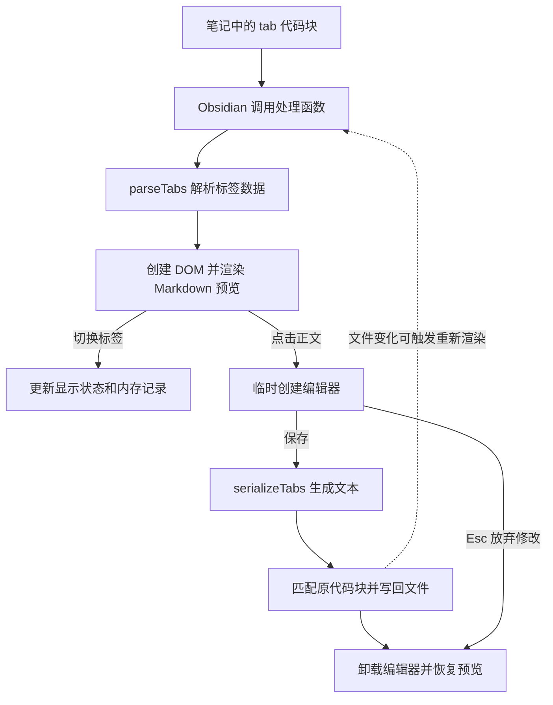

# Obsidian 插件开发入门入门

## 1. 插件开发的基本原理

**Obsidian 插件开发，是在宿主提供的扩展点上注册自己的代码，再通过 API 操作笔记、编辑器和界面。**

Obsidian 桌面端基于 Electron，界面使用 HTML、CSS 和 JavaScript。插件可以像前端代码一样创建 DOM、监听鼠标事件、修改样式，同时还能调用 Obsidian 的能力，例如读取笔记、添加命令和渲染 Markdown。

使用的 Code Tab 为例，可以分成三层：

| 层次 | 职责 | 本插件中的例子 |
| --- | --- | --- |
| Obsidian 宿主 | 管理笔记、渲染 Markdown、提供编辑器和插件生命周期 | 遇到 `tab` 代码块时调用插件 |
| 插件逻辑 | 解析数据、创建交互界面、保存编辑结果 | 把代码块解析成标签，切换标签，回写正文 |
| Web 技术 | DOM、CSS、事件和输入控件 | 创建按钮、隐藏非活动面板、监听点击和键盘 |

这个插件的功能都在应用内部完成，不需要启动 Web 服务。开发时使用 Node.js 执行构建工具，安装 Obsidian 之后由应用加载构建好的 JavaScript。

源码中的导入：

```ts
import { Plugin } from "obsidian";
```

表示使用宿主提供的插件 API。开发依赖里的 `obsidian` 提供类型声明，运行时实现由 Obsidian 应用提供。

### 插件能接入哪些位置

| 需求 | 常用扩展点或 API | 本仓库是否涉及 |
| --- | --- | --- |
| 添加命令面板操作 | `Plugin.addCommand()` | 是，插入标签模板 |
| 自定义代码块的展示 | `registerMarkdownCodeBlockProcessor()` | 是，渲染 `tab` 块 |
| 在容器里显示 Markdown | `MarkdownRenderer.render()` | 是，渲染标签正文 |
| 读取或修改笔记文件 | `app.vault` | 是，保存编辑内容 |
| 操作光标、选区和文本 | `Editor` | 是，插入模板和读写临时编辑器内容 |
| 操作打开的视图和窗格 | `app.workspace` | 当前主要流程不依赖它 |
| 添加设置页面、保存插件配置 | `PluginSettingTab`、`loadData()`、`saveData()` | 当前未实现 |
| 修改输入行为、语法装饰和补全 | `registerEditorExtension()` 与 CodeMirror 6 | 当前没有注册此类扩展 |

先掌握命令、代码块渲染和文件操作，就能实现很多实用插件；深入改造编辑器时再学习 CodeMirror 6。

## 2. Obsidian 怎样加载插件

默认情况下，一个安装好的插件放在笔记库的配置目录中：

```shell
笔记库/
└── .obsidian/
    └── plugins/
        └── obsidian-code-tab/
            ├── manifest.json
            ├── main.js
            └── styles.css
```

三个文件的职责是：

| 文件 | 作用 |
| --- | --- |
| `manifest.json` | 声明插件 ID、名称、版本、作者、最低应用版本 |
| `main.js` | 构建后的插件代码，供 Obsidian 执行 |
| `styles.css` | 插件样式；插件机制允许省略，本项目需要它 |

本仓库的 [manifest.json](../manifest.json) 中，插件 ID 为 `obsidian-code-tab`，显示名称为 `Code Tab`。`minAppVersion` 是声明的最低版本，并不能替代实际兼容性验证，尤其是涉及内部 API 时。

**开发时编辑 `src/`，Obsidian 加载的是构建产物 `main.js`。**

[esbuild.config.mjs](../esbuild.config.mjs) 展示了这个转换过程：

```js
entryPoints: ["src/main.ts"],
outfile: "dist/main.js",
bundle: true,
external: ["obsidian"],
format: "cjs",
```

- `entryPoints` 指定 TypeScript 入口。
- `bundle` 将项目模块打包。
- `external: ["obsidian"]` 保留对宿主 API 的引用。
- `format: "cjs"` 生成 CommonJS 模块，供插件加载器使用。

构建脚本还会把清单和样式复制到 `dist/`，形成可安装的三个文件。

## 3. 从入口理解注册机制

先打开 [src/main.ts](../src/main.ts)。核心结构如下，省略了命令和状态管理：

```ts
export default class CodeTabPlugin extends Plugin {
  async onload() {
    this.registerMarkdownCodeBlockProcessor(
      "tab",
      (source, element, context) => {
        const component = new MarkdownRenderChild(element);
        context.addChild(component);
        renderTabGroup(this, component, element, context, source);
      }
    );
  }
}
```

这里建立了一个约定：

> Obsidian 渲染语言标记为 `tab` 的代码块时，调用处理函数，由插件填充对应的界面。

`onload()` 在插件加载时执行，用来注册功能。它不会为每一个代码块重新执行；随着代码块渲染被调用的是注册进去的处理函数。

处理函数的三个参数是理解这套机制的关键：

| 参数 | 含义 |
| --- | --- |
| `source` | 代码块内部文本，不包含最外层围栏 |
| `element` | 宿主提供的 DOM 容器，插件把界面放进去 |
| `context` | 本次渲染的上下文，包含来源文件路径、源码位置信息和生命周期管理能力 |

插件不必主动扫描整篇笔记来寻找 `tab` 块，Obsidian 已经提供了这个扩展点。

### 命令是另一条独立入口

同一个 `onload()` 还调用了 `addCommand()`。用户执行“Code Tab: 创建标签组件”时，`editorCallback` 获得当前编辑器，并执行：

```ts
editor.replaceSelection(template);
```

有选区时替换选区，没有选区时在光标处插入。模板默认包含两个标签，外层使用四个反引号，方便内部放普通的三反引号代码块。

命令本身只插入文本；文本随后由 Markdown 渲染流程识别，才变成标签界面。这两条入口通过笔记内容衔接。

## 4. 从 Markdown 文本到标签数据

假设笔记里写的是：

````markdown
```tab
tab: Python
这里介绍 Python。

tab: JavaScript
这里介绍 JavaScript。
```
````

`renderTabGroup()` 接收到内部文本，再调用 [src/markdown.ts](../src/markdown.ts) 中的 `parseTabs()`，得到：

```ts
[
  { title: "Python", content: "这里介绍 Python。" },
  { title: "JavaScript", content: "这里介绍 JavaScript。" }
]
```

对应的数据类型定义在 [src/components/types.ts](../src/components/types.ts)：

```ts
export interface TabData {
  title: string;
  content: string;
}
```

解析器逐行处理，并记录当前是否处于内部代码围栏中。只有在围栏外，形如 `tab: 标题` 的声明行才会开启新标签。

例如下面的 `tab: 这是一行代码` 会保留在第一个标签的正文里：

`````markdown
````tab
tab: 示例
```text
tab: 这是一行代码
```

tab: 说明
这里才是第二个标签。
````
`````

源码还规定了几个具体行为：空标题会生成默认名称；正文首尾空行会被裁掉；正文内部空行保留。这些规则由解析函数和测试共同表达。

## 5. 从数据到 DOM 和交互

界面逻辑集中在 [src/components/tabGroup.ts](../src/components/tabGroup.ts) 的 `renderTabGroup()` 中。它依次完成：

1. 解析标签数据，获取来源文件和代码块行号。
2. 创建标签栏与内容面板容器。
3. 为每个标签创建一个按钮和一个内容面板。
4. 渲染各面板中的 Markdown。
5. 注册切换、键盘导航和进入编辑状态的事件。
6. 恢复当前选中的标签。

创建界面的代码就是普通 DOM 操作：

```ts
const button = document.createElement("button");
button.className = "code-tab__tab";
button.textContent = tab.title;
```

项目没有使用 React 或 Vue。Obsidian 的 `Component` 主要负责生命周期管理，不会自动追踪数据变化并重新渲染界面。什么时候创建 DOM、什么时候重新渲染，仍由插件代码决定。

### 切换标签做了什么

点击按钮后执行 `activate(index)`，主要更新：

- 当前选中的索引及 `plugin.activeTabs` 中的记录。
- 按钮的 `is-active` 样式类。
- `aria-selected`、`tabindex` 等辅助访问属性。
- 各面板的 `hidden` 状态。

因此切换标签不用重新解析整个文件，也不需要写文件。[src/styles.css](../src/styles.css) 中的 `.code-tab__panel[hidden]` 配合这个状态隐藏非活动面板。

方向键、`Home` 和 `End` 也会调用 `activate()`，从而复用同一套切换逻辑。

### Markdown 正文由谁渲染

`renderPanel()` 使用公开 API：

```ts
await MarkdownRenderer.render(
  plugin.app,
  previewSource,
  panel,
  context.sourcePath,
  component
);
```

这五个参数分别是宿主应用、Markdown 文本、目标容器、来源文件路径和生命周期组件。`sourcePath` 用于解析相对链接，`component` 用于管理渲染产生的子组件。

插件不必自己实现列表、链接和代码块的 Markdown 渲染。浏览时为各标签创建的是预览内容；完整的原生编辑器只在进入编辑状态时创建。

渲染前，`normalizePreviewFenceLanguages()` 会把 `c++`、`c#` 等语言标记转换成预览高亮器能识别的别名。转换只作用于预览副本，保存时使用的原始标签内容保持原有语言标记。

## 6. 编辑和保存：从界面回到 Markdown

本插件形成了一个完整的数据闭环：



### 进入和退出编辑

当前实现中，单击正文区域会进入 `startEditing()`。普通链接、输入控件等有自己的点击行为，事件处理器会跳过它们。

一个标签组同一时间只维护一个编辑会话。编辑期间不能切到其他标签，以减少切换与保存之间的竞争。

| 操作 | 当前行为 | 是否写笔记 |
| --- | --- | --- |
| 点击标签标题 | 切换显示面板 | 否 |
| 单击正文 | 创建临时编辑器 | 否 |
| 鼠标离开内容面板 | 保存并退出编辑 | 内容变化时写入 |
| `Ctrl/Cmd + Enter` | 保存并退出编辑 | 内容变化时写入 |
| `Esc` | 放弃本次修改并退出编辑 | 否 |

当前版本没有新增、删除、重命名或拖拽标签的按钮。这些结构调整通过编辑源 Markdown 完成。旧版本的操作方式不能直接套用到当前实现。

### 保存调用链

```text
save()
→ 读取编辑器中的 Markdown
→ 创建 nextTabs，保留其他标签的数据
→ serializeTabs(nextTabs)
→ updateMarkdownSource(...)
→ 文件写入成功后更新 tabs 和 source
→ leaveEditor() 卸载编辑器，恢复预览
```

保存层看到的是字符串。原生编辑器通过 `editor.getValue()` 提供字符串，降级输入框通过 `textarea.value` 提供字符串，两者复用同一套保存逻辑。

代码先写文件，再提交内存里的新标签数据。如果写入失败，会显示 `Notice` 并保留编辑会话，避免界面提前显示为已保存。

### 怎样找到应该修改的代码块

一个文件可以有多个 `tab` 块，编辑期间也可能有其他窗格或同步工具修改文件。因此只记住旧行号是不够的。

`updateMarkdownSource()` 按以下过程处理：

1. 根据 `context.sourcePath` 定位 Markdown 文件。
2. 在当前文件内容中查找正文与编辑前 `source` 一致的 `tab` 块；比较时统一换行格式。
3. 如果有多个匹配块，选择最接近原始行号的一个。
4. 生成新的外层围栏，替换匹配块，并保留其他文件内容。
5. 如果没有匹配块，停止保存并提示原标签块已经发生变化。

这是基于旧内容匹配的乐观并发检查。多个完全相同的代码块之间仍依赖行号判断，并没有为每个块分配持久化的唯一 ID。

现代 API 路径使用：

```ts
await app.vault.process(file, update);
```

由 Vault 在一次处理流程中完成读取、转换和写入。没有 `process()` 的旧版宿主会退回到 `read()` 加 `modify()`；分开的读写不能提供与 `process()` 相同的并发保护。

当前保存路径不依赖“哪个窗格处于激活状态”，而是使用渲染上下文提供的来源路径。`Editor` 主要用于模板插入和临时编辑器的内容操作。

### 为什么需要重新生成围栏

如果用户在正文中加入代码块，外层 `tab` 围栏必须比内部同类围栏更长，否则内部的结束标记可能提前关闭外层容器。

`createTabFence()` 扫描正文，选择足够长的围栏，并沿用原块的围栏类型、外层缩进和文件换行风格。这样，编辑标签里的代码也属于保存逻辑需要考虑的情况。

## 7. 区分笔记数据和界面状态

| 数据 | 保存在哪里 | 重启或重新加载后的情况 |
| --- | --- | --- |
| 标签标题、正文、顺序 | 笔记的 Markdown 代码块 | 保留 |
| 当前选中哪个标签 | 插件实例的 `activeTabs` Map | 插件重新加载后清空 |
| 尚未保存的编辑内容 | 当前临时编辑器 | 不属于已经保存的笔记数据 |
| 插件设置 | 当前没有实现 | 可在后续通过 `loadData()`、`saveData()` 实现 |

修改笔记后，Obsidian 可能重建整个代码块组件。把选中索引放到插件实例中，组件重建时就能尝试恢复选中位置。

当前 Map 的键是“来源文件路径 + 代码块起始行”。插入前文导致行号变化时，键也可能变化；它用于保存短期显示状态，不是稳定的块身份。

**插件关闭后，标题和正文仍然是普通 Markdown 文本。** 失去的是标签页的交互呈现，笔记内容本身仍在文件里。

## 8. 生命周期：为什么组件需要被卸载

代码块可能因为修改笔记、关闭页面或重新渲染而离开 DOM，插件也可能被禁用。此前注册的事件和创建的编辑器需要随之清理。

入口中的：

```ts
const component = new MarkdownRenderChild(element);
context.addChild(component);
```

把当前代码块交给 Markdown 渲染器管理。`MarkdownRenderChild` 继承 `Component`，并用 `containerEl` 对应渲染区域；该区域被移除时，渲染器可以卸载组件。

项目使用了两种资源管理方式：

| 方式 | 代码例子 | 清理责任 |
| --- | --- | --- |
| 交给组件登记 | `component.registerDomEvent(...)`、`component.addChild(editorView)` | 组件卸载时处理登记的事件和子组件 |
| 编辑会话手工管理 | `addEventListener("mouseleave", save)`、编辑器键盘监听 | `leaveEditor()`、`destroyEditor()` 在退出编辑时解绑或卸载 |

临时编辑器结束使用时，代码调用 `component.removeChild(editorView)`，及时卸载它。插件自身的 `onunload()` 则清空 `activeTabs`。

以后加入定时器时，可以使用 `registerInterval()` 让生命周期管理它；当前版本没有旧实现中的索引保活定时器。

读这部分时可以始终问两个问题：这个资源由谁创建？正常退出和整个组件卸载时，分别由谁负责清理？

## 9. 公开 API 与内部 API

本项目的浏览态使用公开的 `MarkdownRenderer.render()`。编辑态则需要额外理解，因为它使用了 Obsidian 的内部 Markdown embed：

```ts
const embedCreator = embedRegistry.getEmbedCreator({ extension: "md" });
```

随后创建实例、登记到父组件、启用编辑，并调用 `showEditor()`。这样可以复用 Obsidian 的输入、光标、选区和语法高亮能力。

`embedRegistry` 及相关 embed 行为不属于本插件可依赖的公开稳定契约。[types.ts](../src/components/types.ts) 中的 `AppWithEmbedRegistry`、`NativeMarkdownEmbed` 是项目为实际使用的部分补充的类型声明。**补充类型不会让内部接口变成公开 API。**

因此代码会检测编辑器是否可用，失败时创建可见的 `textarea`，继续提供基本编辑和保存能力。原生编辑器只在需要时创建，退出编辑后即卸载。

入门时建议先做只读标签页，掌握公开渲染 API；再学习文本保存；最后研究内部编辑器。这样每一步的职责和故障范围都比较明确。

## 10. 按什么顺序读源码

| 顺序 | 文件和函数 | 读完应该能回答的问题 |
| --- | --- | --- |
| 1 | [manifest.json](../manifest.json)、[package.json](../package.json)、[esbuild.config.mjs](../esbuild.config.mjs) | 什么代码被构建，什么文件被 Obsidian 加载？ |
| 2 | [main.ts](../src/main.ts) 的 `onload()` | 代码块处理器和命令分别在什么时候执行？ |
| 3 | [types.ts](../src/components/types.ts) 的 `TabData`、[markdown.ts](../src/markdown.ts) 的 `parseTabs()` | 原始文本怎样变成结构化数据？ |
| 4 | [tabGroup.ts](../src/components/tabGroup.ts) 的 DOM 创建、`activate()`、`renderPanel()` | 数据怎样变成可切换界面？ |
| 5 | 同文件的 `startEditing()`、`save()`、`leaveEditor()` | 编辑会话如何开始、保存、取消和结束？ |
| 6 | [markdown.ts](../src/markdown.ts) 的 `serializeTabs()`、`updateMarkdownSource()`、`findTabBlock()`、`createTabFence()` | 怎样定位原块，避免覆盖已经改变的内容？ |
| 7 | [styles.css](../src/styles.css)、[markdown.test.mjs](../tests/markdown.test.mjs) | 样式怎样适应主题，哪些文本行为已有自动检查？ |

第一次读 `tabGroup.ts` 时，可以先把创建原生编辑器的部分当作一个“提供文本输入”的模块。先走通外围的数据流，再细读其内部 API。

## 11. 本地构建、安装与调试

本项目要求 Node.js 20 或更高版本。以下命令在仓库根目录执行：

```bash
npm ci
npm run build
```

`npm run build` 包含 TypeScript 类型检查，然后生成 `dist/main.js`、`dist/manifest.json`、`dist/styles.css`。

将这三个文件复制到测试笔记库的 `.obsidian/plugins/obsidian-code-tab/`，在 Obsidian 的第三方插件设置里启用 Code Tab。已经启用时，关闭再打开插件或重启应用以加载新代码。

持续开发时运行：

```bash
npm run dev
```

当前监听脚本会监测源码、样式和清单变化，并更新 `dist/`。它不做类型检查，也不会自动把产物复制到笔记库。构建、复制产物和重新加载插件是三个步骤；当前脚本不接受旧工具的 `--vault-path` 或 `--with-stylesheet` 参数。

### 第一个调试点

在 macOS 的 Obsidian 中按 `Cmd + Option + I` 打开开发者工具，在代码块处理函数内临时添加：

```ts
console.log("Code Tab render", {
  source,
  sourcePath: context.sourcePath,
  section: context.getSectionInfo(element),
});
```

这能直接展示“笔记中的文本如何进入插件”。`getSectionInfo()` 可能返回 `null`，后续使用位置信息时需要处理这种情况，当前 `getGroupInfo()` 也有对应分支。

再在笔记中放入两个标签，观察切换、进入编辑、保存后日志的变化。Elements 面板则可以查看 `is-active` 类和 `hidden` 属性，确认状态变化如何影响界面。

### 检查分成两层

```bash
npm test
npm run build
```

现有自动测试主要覆盖 Markdown 解析、嵌套围栏、序列化、语言别名、LF/CRLF、多个块定位和冲突拒绝。测试中的 Vault 是模拟对象；这些测试不能证明原生编辑器或主题样式在真实 Obsidian 中运行正常。

修改界面或编辑器后，再在 Obsidian 中检查：

- 标签可以通过鼠标和键盘切换。
- 内容、链接和内部代码块正常显示。
- 单击正文能进入编辑，鼠标移出或快捷键能保存。
- `Esc` 放弃修改，多代码块笔记保存到正确的位置。
- 亮色和暗色主题下内容可见、焦点清楚。

## 12. 三轮上手练习

### 第一轮：走通开发反馈

修改 `main.ts` 中的默认模板，再调整 `.code-tab__tab.is-active` 的样式。使用 `var(--interactive-accent)`、`var(--text-normal)` 等主题变量，观察不同主题下的效果。

这一轮的目标是熟悉“修改源码 → 构建 → 安装产物 → 重新加载 → 观察效果”。

### 第二轮：理解显示状态

为标签组增加一个“当前为第几个标签”的显示，例如 `2 / 3`，在 `activate()` 中同步更新。这个信息只属于界面状态，不需要写进笔记。

这一轮练习 DOM 创建、事件响应和状态更新，同时保持正文保存逻辑不变。

### 第三轮：理解完整写回

尝试增加“复制当前标签”按钮。需要生成新的标签数据、序列化、调用已有保存函数，并在成功后更新界面；还要考虑编辑期间能否复制，以及原块被其他窗格修改时如何处理。

这一轮把数据、界面和文件保存连起来。完成后，你应该能够独立解释本插件的主要链路，并把相同方法应用到其他自定义 Markdown 组件中。

## 参考资料

- [本项目 README](../README.md)：当前安装方式、功能和交互约定。
- [Obsidian 开发者文档](https://docs.obsidian.md/)：插件生命周期、编辑器和 UI 扩展。
- [Obsidian API 类型声明](https://github.com/obsidianmd/obsidian-api)：确认公开 API 的参数与能力边界。
- [官方示例插件](https://github.com/obsidianmd/obsidian-sample-plugin)：查看最小项目结构和常见注册方式。

本文是基于当前源码的阅读指南，不代表每个声明支持的 Obsidian 版本都已经完成运行验证。实际开发以当前源码、依赖的 API 类型和应用内调试结果共同为准。
